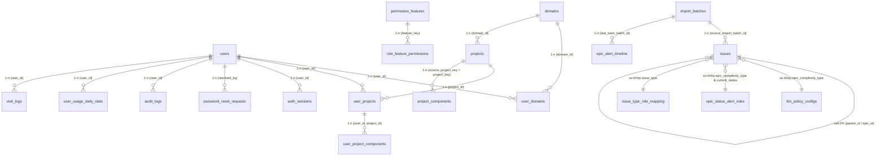

# 08 — Data Model

> **Nguồn cấu trúc hiện hành (2026-10-20):** ERD + từ điển dữ liệu sinh tự động từ CSDL ở `docs/database-erd.md`; DDL tạo CSDL mới (không dữ liệu) ở `db/install/ttm-monitor-schema.sql` (hướng dẫn `db/install/README.md`); cả hai cùng chương 5 Tài liệu sản phẩm do `npm run db:export-schema` sinh. Các mục dưới đây là lịch sử thiết kế từng phần.

> Nguồn sự thật là `db/schema.sql` (bootstrap cho DB mới) + toàn bộ file trong `db/migrations/*.sql`
> (không tính `.down.sql`). File này diễn giải lại đúng theo hai nguồn đó; khi có khác biệt, luôn ưu
> tiên đọc trực tiếp `db/schema.sql`/`db/migrations`. Ứng dụng chạy song song 2 profile DB (local,
> Supabase — xem `AGENTS.md`; Aiven đã ngừng sử dụng từ 26/09/2026), migration phải áp dụng cho cả 2 khi thay đổi schema.

## 1. Nguyên tắc mô hình dữ liệu

Database dùng PostgreSQL. Không có bảng `roles`/`user_roles`/`business_domains`/`alerts`/
`data_source_configs` — đây là các khái niệm cũ đã bị thay bằng thiết kế đơn giản hơn (role là 1
cột CHECK trên `users`, alert được tính live không lưu bảng riêng, xem bên dưới).

Dữ liệu chia thành các nhóm:

- Auth và RBAC (`users`, `user_domains`, `user_projects`, `user_project_components`,
  `auth_sessions`, `password_reset_requests`, `permission_features`, `role_feature_permissions`).
- Domain và Project (`domains`, `projects`, `project_components`).
- Jira/CSV canonical issue data (`issues`, `import_batches`).
- Cấu hình TTM và cảnh báo (`ttm_policy_configs`, `epic_status_alert_rules`,
  `issue_type_role_mapping`).
- Lịch làm việc (`holidays`, `makeup_workdays`).
- Lịch sử/audit & tương tác (`epic_alert_timeline`,
  `audit_logs`, `user_usage_daily_stats`, `visit_logs`).
- Cấu hình chung (`jira_settings`, `data_retention_configs`).
- Thông báo trong ứng dụng (`ad_popups`, `ad_popup_impressions`, `info_banners`) — mục 20.
- SSO/API Key & MCP Server (`api_keys`, `sso_auth_codes`, `mcp_settings`, `mcp_access_tokens`,
  `mcp_access_daily_stats`, `mcp_oauth_clients`, `mcp_oauth_authorization_codes`) — mục 21.
- Visit Counter (`visit_logs`) — mục 22.

## 1.1. Sơ đồ cấu trúc cơ sở dữ liệu (ERD Diagram)

Sơ đồ ERD dưới đây mô tả cấu trúc thực tế của **39 bảng/thực thể** trong CSDL PostgreSQL của ứng dụng
TTM Monitor (28 bảng nghiệp vụ & thống kê cốt lõi + 10 bảng hạ tầng tích hợp mới hơn — mục 20/21 + bảng `visit_logs` — mục 22),
phân chia theo 9 nhóm chức năng. Sơ đồ mermaid dưới đây chỉ vẽ 7 nhóm cốt lõi cho gọn — 2 nhóm mới
xem chi tiết dạng text tại mục 20/21:




## 2. users

```text
id
email                -- UNIQUE, dùng để đăng nhập — KHÔNG có cột username riêng
full_name
password_hash        -- bcrypt hash, không lưu plaintext
role                  -- CHECK IN ('SUPERADMIN','ADMIN','SUPERVISOR','USER') — 4 role, không phải 3
is_active
must_change_password -- BOOLEAN NOT NULL DEFAULT TRUE (thêm bởi 20260905c) — bắt đổi mật khẩu ở lần
                      -- đăng nhập kế tiếp; chỉ seed FALSE cho minhnd7@mbbank.com.vn
failed_login_attempts -- INT NOT NULL DEFAULT 0 (20260919_add_failed_login_lockout.sql) — đếm lần đăng nhập
                      -- sai liên tiếp; tới ngưỡng thì khoá tài khoản và tạo ticket mở khoá cho Admin
last_login_at
created_at
updated_at
```

Không tồn tại bảng `roles`/`user_roles` — role là một cột CHECK trực tiếp trên `users`.

**4 role** (không phải 3 như tài liệu cũ):

| Role kỹ thuật | Role nghiệp vụ | Phạm vi | Ghi chú |
|---|---|---|---|
| SUPERADMIN | CBQL Phòng | Toàn hệ thống | Toàn quyền |
| SUPERVISOR | (không có tên nghiệp vụ riêng) | Toàn hệ thống, **read-only** | Xem như SUPERADMIN nhưng không có quyền tạo/sửa/xóa ở bất kỳ màn hình quản trị nào, không truy cập các thao tác xử lý dữ liệu (import/backup/purge). Thêm bởi `20260824_add_supervisor_role.sql`. |
| ADMIN | Lead | Theo Domain được gán (`user_domains`) **và** các Dự án mà chính Admin làm PM/SM (`user_projects`, cả dự án — không thu hẹp theo Component) | Áp dụng cho mọi màn hình dữ liệu Epic (TTM Dashboard 2, Quản trị Epic, Chuẩn hoá dữ liệu, Báo cáo Epic, MCP) qua `resolveAccessScope` (`epic-alert-service.ts`), từ 2026-10-04. TTM Dashboard, Epic in PO và Quản trị Epic rút gọn đã gỡ ngày 2026-10-11. Riêng TTM Dashboard 2 có "Lead view cho tất cả user" (§23 `dashboard_view_settings`): số liệu tổng hợp toàn công ty, danh sách Epic mở ra vẫn theo phạm vi của user. |
| USER | PM-SM | Theo Dự án được gán (`user_projects`, có thể bị thu hẹp theo Component — xem `user_project_components`) | |

Seed mặc định (`db/schema.sql`): `minhnd7@mbbank.com.vn` (SUPERADMIN), `ngothanhha@mbbank.com.vn`
(ADMIN), `congha@mbbank.com.vn` (USER).

## 3. user_domains / user_projects / user_project_components

```text
user_domains(user_id, domain_id)              -- PK kết hợp, nhiều-nhiều
user_projects(user_id, project_id)            -- PK kết hợp, nhiều-nhiều — cấp quyền PM/SM full 1 dự án
user_project_components(user_id, project_id, component_name)
                                                -- PK kết hợp, FK tới (user_id, project_id) của user_projects
                                                -- thu hẹp 1 dự án đã cấp trong user_projects xuống
                                                -- chỉ những Epic có issues.components giao với danh sách
                                                -- component_name này. Không có dòng nào cho 1 dự án
                                                -- = không giới hạn (full quyền dự án đó), giữ đúng
                                                -- hành vi user_projects cũ.
```

`user_project_components` thêm bởi `20260821_add_component_level_permissions.sql`, cùng lúc với cột
`issues.components TEXT[]` (Epic's Jira Component/s, dùng để so khớp). Chỉ áp dụng cho role USER
(PM/SM) — ADMIN/SUPERVISOR/SUPERADMIN không bị giới hạn theo Component.

## 4. domains

```text
id
domain_code           -- UNIQUE
domain_name
description
lead_name             -- text tự do, chọn từ user active trên UI (không phải FK)
is_active
created_at
updated_at
```

Tên bảng thật là `domains`, **không phải** `business_domains`. Không có cột `lead_user_id`.

## 5. projects

```text
id
project_name
domain_id             -- FK domains(id) ON DELETE SET NULL
source_project_key    -- UNIQUE, NOT NULL — Jira Project Key, DÙNG DUY NHẤT một trường project key
                       -- (cột project_key cũ đã bị DROP — xem 20260827_drop_project_key_use_source_key.sql)
source_type           -- mặc định 'JIRA'
project_category      -- CHECK IN ('Dự án','Team Agile','Team Triển khai'), nullable
ttm                    -- CHAR(1) CHECK IN ('Y','N'), mặc định 'N' — 'N' = "Epic ngoại lệ" (PROJECT_NON_TTM, §23)
is_active
created_at
updated_at
project_code          -- VARCHAR(50), PMS Project Core (20261009b): mã nghiệp vụ, backfill = source_project_key;
                       -- trigger projects_fill_project_code điền khi INSERT không truyền (code TTM chưa biết cột này)
project_type_id       -- FK project_types(id) ON DELETE SET NULL (20261009b), backfill từ project_category
```

`project_code` / `project_type_id` thuộc module PMS (expand-only, xem §24) — **chưa có code nào đọc**;
TTM vẫn dùng `source_project_key` và `project_category`.

Không còn khái niệm "Mã hiển thị" tách biệt Source Project Key — `source_project_key` vừa là khóa
join với `issues`/`project_components` vừa là mã hiển thị duy nhất trên UI. Cột `lead_name` (PM/SM
hiện tại) đã bị **DROP** khỏi bảng này (`20260908_drop_projects_lead_name.sql`) — PM/SM hiện tại
không còn là 1 cột lưu sẵn, mà được suy ra **live** bằng join `user_projects` + `users` (xem
`listProjects`/`getProjectById` trong `master-data-service.ts`). Popup thêm/sửa Dự án không cho gán
PM/SM (chỉ hiển thị PM/SM hiện tại + component được phân quyền của PM/SM đó, đọc từ
`user_project_components`); gán/đổi PM/SM thực hiện tại `/admin/users`, đồng bộ hai chiều trong
transaction (`auth-service.ts`'s `replacePermissions`).

## 6. project_components

```text
id
project_key          -- = projects.source_project_key (Jira key), KHÔNG phải project_id
component_name
is_active
created_at
updated_at
```

Unique `(project_key, component_name)`. Tích lũy tự động từ mỗi lần import CSV issue (Epic/Story's
Component/s field) qua `project-component-service.ts`, và có thể bổ sung thủ công qua tab
"Import Components" ở Nguồn dữ liệu (cùng bảng, cùng semantics upsert). Component cũ không bị xóa
khi không còn xuất hiện trong batch mới; `is_active` quyết định có hiện trong dropdown hay không.

## 7. issues (bảng gộp lưu mọi issue — Epic/Story/Subtask)

```text
id
source_system              -- mặc định 'JIRA'
jira_id                    -- BIGINT, ID gốc Jira
issue_key                  -- ví dụ WM-31288
issue_name
issue_type                 -- EPIC/CTNB (cấp 1), STORY/TASK/ENABLER STORY (cấp 2), còn lại = Subtask (cấp 3)
current_status
standard_status
ttm_stage
assignee_name
epic_key                   -- set trực tiếp bởi Py Jira API adapter trên mọi cấp, kể cả Subtask
parent_key
parent_id                  -- self-FK issues.id, ON DELETE SET NULL
epic_id                    -- self-FK issues.id, ON DELETE SET NULL
idea_approved_date         -- T0 (bắt đầu TTM-E2E)
start_date                 -- T1 (bắt đầu TTM-CNTT)
r4g_date                   -- kết thúc TTM-CNTT (nhập tay trên Jira)
due_date                   -- kết thúc TTM-E2E (nhập tay trên Jira)
target_r4g_date
target_due_date
jira_created_at            -- epic_created (Py Jira API adapter)
jira_updated_at             -- epic_updated (Py Jira API adapter)
epic_complexity_type       -- CT-Lv12 / CT-Lv34 / SP-Lv12 / SP-Lv34 (từ 09/2026 — xem 02-ttm-concepts-and-rules.md §2;
                            -- legacy SIMPLE/COMPLEX vẫn được CHECK constraint chấp nhận nhưng không còn Epic nào mang giá trị này)
requirement_level
components                 -- TEXT[], Epic/Story's Jira Component/s — dùng cho lọc theo Component
epic_stories                -- TEXT[], danh sách Story key con trực tiếp của Epic (Py Jira API adapter)
story_subtasks              -- TEXT[], danh sách Subtask key con trực tiếp của Story (Py Jira API adapter)
previous_status            -- VARCHAR(50), ghi nhận status trước của status hiện tại (Py Jira API: epic_previous_status)
khau_ba                    -- TEXT, vai trò khâu BA gây ra vấn đề Fail TTM-CNTT (epic_khau_ba)
khau_co                    -- TEXT, vai trò khâu CO (epic_khau_co)
khau_dev                   -- TEXT, vai trò khâu DEV (epic_khau_dev)
khau_pm_sm                 -- TEXT, vai trò khâu PM/SM (epic_khau_pm_sm)
khau_po                    -- TEXT, vai trò khâu PO (epic_khau_po)
khau_pentest               -- TEXT, vai trò khâu Pentest (epic_khau_pentest)
khau_sa                    -- TEXT, vai trò khâu SA (epic_khau_sa)
khau_sit_uat               -- TEXT, vai trò khâu SIT/UAT (epic_khau_sit_uat)
note_ly_do_khac            -- TEXT, ghi chú lý do khác gây ra vấn đề Fail TTM-CNTT (epic_note_ly_do_khac)
main_fail_dept             -- TEXT, "Phòng chịu trách nhiệm chính" của Fail TTM (CSV main_fail_dept,
                            -- 20261014d_add_main_fail_dept_to_issues.sql); trống hoặc "None" = thiếu
ttm_applied                -- TEXT, CSV "TTM-applied" (20261102_add_ttm_applied_to_issues.sql)
except_ttm_plan            -- TEXT, CSV "except-TTM-plan" (cùng migration)
source_import_batch_id     -- FK import_batches(id) ON DELETE CASCADE
aggregated_at               -- lớp dữ liệu (thời điểm chốt dữ liệu)
created_at
updated_at
```

Không có `project_id`/`domain_id` FK trực tiếp trên `issues` — Project nằm ở cột `issues.project_key`
(Project key của file, không có thì lấy tiền tố `issue_key`; xem `epic-alert-service.ts`). Không có `owner_user_id`.

**Không có cột KPI/cảnh báo nào trên `issues`** (`ttm_cntt_result`, `ttm_cntt_alert_level`,
`current_alert_text`… không tồn tại). Kết luận của từng Epic do Scoring Service (`src/lib/scoring/`)
tính và được **lưu ở bảng cache dẫn xuất** `epic_alert_row_cache` (§23) mỗi lần `refreshDerivedCaches`
chạy (sau import, lượt đầu ngày, khi đổi cấu hình/Epic ngoại lệ/dự án/domain/PM-SM, nút "Tạo lại
cache"); các màn hình đọc cache này chứ không tính lại mỗi request. `issues` chỉ chứa dữ liệu Jira.
Các trường lý do Fail (`khau_*`, `note_ly_do_khac`, `main_fail_dept`) được Scoring Service đọc cho
2 khuyến nghị "Thiếu lý do Fail TTM" / "Thiếu phòng chịu TN chính" (`16-ttm-indexes.md`).
`issues` còn là nguồn bằng chứng của Từ chối import (Epic từng ở status khác Released sau ngày B —
`07-data-source-and-csv-import.md` §2.2) và của Epic deletion khi xác định phạm vi xoá. Từ 2026-10-23
lịch sử Issue chỉ còn trong `issues` (hai bảng snapshot đã gỡ).

Khóa duy nhất: `(issue_key, source_import_batch_id)` — cho phép cùng 1 issue xuất hiện ở nhiều batch
(lớp dữ liệu) khác nhau; "trạng thái mới nhất" của 1 issue luôn là bản ghi có `aggregated_at` lớn
nhất trong toàn bộ lịch sử (`LATEST_ISSUES_CTE`, `issue-resolution-sql.ts`), không phải bản ghi
trong batch gần nhất.

**Quy tắc phân loại Epic (`epic_complexity_type` — cập nhật 09/2026):**
Lúc import dữ liệu, hệ thống tự động tính toán `epic_complexity_type` cho từng Epic (`computeEpicComplexity` trong `import-service.ts`) dựa vào 2 trường từ Jira: `epic_request_type` (Loại yêu cầu) và `epic_request_level` (Mức yêu cầu):
- **CT-Lv12**: Loại yêu cầu ∈ {`Tính năng mới`, `Cải tiến`} và Mức yêu cầu ∈ {`1`, `2`} (*mặc định an toàn cho mọi trường hợp thiếu hoặc không khớp dữ liệu*).
- **CT-Lv34**: Loại yêu cầu ∈ {`Tính năng mới`, `Cải tiến`} và Mức yêu cầu ∈ {`3`, `4`}.
- **SP-Lv12**: Loại yêu cầu ∈ {`Sản phẩm/dịch vụ/quy trình mới`, `Sản phẩm`} và Mức yêu cầu ∈ {`1`, `2`}.
- **SP-Lv34**: Loại yêu cầu ∈ {`Sản phẩm/dịch vụ/quy trình mới`, `Sản phẩm`} và Mức yêu cầu ∈ {`3`, `4`}.

Tất cả các bản ghi Epic lịch sử đã được backfill tự động sang 4 loại mới thông qua migration `20260908c_backfill_epic_complexity_types.sql`.

## 8. Chỉ mục hiệu năng trên issues

```sql
CREATE UNIQUE INDEX idx_issues_key_batch ON issues (issue_key, source_import_batch_id);
CREATE INDEX idx_issues_epic_id ON issues (epic_id) WHERE epic_id IS NOT NULL;
CREATE INDEX idx_issues_parent_id ON issues (parent_id) WHERE parent_id IS NOT NULL;
CREATE INDEX idx_issues_batch_id ON issues (source_import_batch_id);
CREATE INDEX idx_issues_aggregated_at ON issues (aggregated_at);
CREATE INDEX idx_issues_type_status ON issues (issue_type, current_status);
-- 20260828: tăng tốc LATEST_ISSUES_CTE (DISTINCT ON issue_key ORDER BY aggregated_at DESC)
CREATE INDEX idx_issues_key_aggregated_at ON issues (issue_key, aggregated_at DESC);
```

## 9. holidays / makeup_workdays

```text
holidays: id, name, holiday_type, is_multi_day, start_date, end_date, description, is_active, created_at, updated_at
makeup_workdays: id, work_date (UNIQUE), description, is_active, created_at, updated_at
```

- `holidays`: nếu `is_multi_day = false` thì `end_date = start_date`; nếu `true` thì
  `end_date >= start_date` (CHECK constraint).
- `makeup_workdays` ("Ngày làm bù", thêm bởi `20260904_create_makeup_workdays.sql`) — **ngược lại**
  với `holidays`: khai báo một ngày Thứ Bảy/Chủ Nhật cụ thể là ngày làm việc bình thường (bù cho kỳ
  nghỉ dài trước/sau đó). Một ngày nằm trong `makeup_workdays` luôn thắng cả rule cuối tuần lẫn
  `holidays` khi tính working-day (`working-days.ts`'s `HolidaySet`, nạp qua
  `master-data-service.ts`'s `getActiveHolidaySet`).

## 10. epic_status_alert_rules

```text
id
epic_complexity_type      -- CT-Lv12 / CT-Lv34 / SP-Lv12 / SP-Lv34 (CHECK cũng vẫn chấp nhận SIMPLE/COMPLEX cho các dòng cũ, xem mục 6)
epic_status                -- Design / In Progress / ... (không giới hạn dropdown, tối đa 50 ký tự)
early_alert_offset_days
late_alert_offset_days
is_active
created_at
updated_at
-- KHÔNG CÒN fail_offset_days — cột này đã bị DROP (20260816_separate_ttm_policy_from_alert_offsets.sql)
```

Ràng buộc: unique `(epic_complexity_type, epic_status)`; `early_alert_offset_days <
late_alert_offset_days` (không còn ràng buộc 3 chiều với fail vì fail không còn nằm ở bảng này).
Mốc Fail TTM giờ tính hoàn toàn từ `ttm_policy_configs` (mục 11), tách khỏi rule Cảnh báo sớm/muộn.

Dữ liệu seed gốc (`db/schema.sql`, nay là dữ liệu **legacy** không còn áp dụng): SIMPLE/Design 2-3,
SIMPLE/In Progress 12-13, COMPLEX/Design 5-6, COMPLEX/In Progress 19-20 (đơn vị ngày làm việc). CHECK
constraint được nới rộng (`20260908b_widen_epic_complexity_types.sql`) để giữ nguyên các dòng này thay
vì xóa, nhưng **admin cần tự thêm rule mới cho 4 epic-type CT-Lv12/CT-Lv34/SP-Lv12/SP-Lv34** tại panel
"Quy tắc cảnh báo Epic" — tại thời điểm cập nhật tài liệu này, 4 loại mới **chưa có rule nào**.

## 11. ttm_policy_configs

```text
id
ttm_type              -- CHECK IN ('TTM_CNTT','TTM_E2E')
epic_complexity_type  -- CHECK IN ('SIMPLE','COMPLEX','CT-Lv12','CT-Lv34','SP-Lv12','SP-Lv34')
from_ttm_field        -- VARCHAR(100), TEXT TỰ DO — CHECK enum ('IDEA_APPROVED_DATE','START_DATE') đã
                       -- bị DROP (20260817_allow_free_text_ttm_fields.sql) để chừa chỗ map field mới
to_ttm_field           -- VARCHAR(100), TEXT TỰ DO — CHECK enum ('R4G_DATE','DUE_DATE') đã bị DROP
                       -- cùng migration trên, cùng lý do
working_days           -- 1–3650
is_active
created_at
updated_at
```

`from_ttm_field`/`to_ttm_field` không còn ràng buộc CHECK — engine (`ttm-policy-service.ts`) nhận
diện qua alias chuẩn của Idea Approved Date/Start Date/R4G Date/Due Date, giá trị lạ được lưu nguyên
để dành sẵn cho việc bổ sung mapping dữ liệu sau, không bị DB từ chối.

Unique `(ttm_type, epic_complexity_type)`. Đây là **nguồn duy nhất** của mốc hạn TTM (thay
`fail_offset_days` cũ). Seed mặc định lúc tạo bảng (nay là legacy): TTM_CNTT SIMPLE=15 ngày, TTM_CNTT
COMPLEX=30 ngày, TTM_E2E SIMPLE=30 ngày, TTM_E2E COMPLEX=50 ngày. Giá trị đang active cho 4 epic-type
mới (do CBQL Phòng tự cấu hình, có thể thay đổi bất kỳ lúc nào — xem `02-ttm-concepts-and-rules.md`
§2 để biết giá trị hiện tại): CT-Lv12/CT-Lv34/SP-Lv12/SP-Lv34, mỗi loại có 1 dòng TTM_CNTT + 1 dòng
TTM_E2E.

**Fail TTM-E2E là cảnh báo độc lập với Fail TTM-CNTT** (không phải chỉ tham chiếu như tài liệu cũ mô
tả) — tính bởi rule `E2E_FAIL` của Scoring Service (`scoring/rules/ttm-e2e.ts`; đường kẻ của dải: `epic-row-geometry.ts`): T0 = Idea Approved Date, nếu thiếu
thì fallback `jira_created_at` (luôn có), nên baseline TTM-E2E luôn tính được bất kể Start Date có
hay không; chỉ có FAIL/NONE, không có mức Cảnh báo sớm/muộn riêng cho TTM-E2E.

## 12. Lịch sử/audit (append-only, không phải bảng nghiệp vụ sống)

### epic_alert_history (đã gỡ 2026-10-24)

Bảng lịch sử cảnh báo từng ngày (LATE/FAIL, `phase`) đã được gộp vào `epic_alert_timeline`: migration
`20261024b_drop_epic_alert_history.sql` copy Status của Epic vào `detail.status` của từng đợt
`FAIL_TTM_CNTT` / `LATE_TTM_CNTT` rồi `DROP` bảng. Hai chức năng từng dùng bảng này nay đọc timeline:
(a) rule "Epic Released chỉ còn hiển thị trên Quản trị Epic nếu từng có cảnh báo" =
`getEpicKeysWithCnttAlertRuns()` (có ít nhất 1 đợt Fail/Cảnh báo muộn TTM-CNTT); (b) API
`GET /api/epic-alerts-15/[epicKey]/alert-history` trả `alerts` (các đợt, mỗi đợt có ngày bắt đầu/kết
thúc/status) thay cho `history` từng ngày. Việc ghi cảnh báo theo pha Epic 15 (đã tắt từ trước) bị gỡ cùng bảng.

### epic_milestone_history (đã gỡ 2026-10-24)

Bảng ghi ngày Epic đạt mốc DESIGN_DONE / DEV_DONE / TEST_DONE. Đường ghi đã tắt từ lâu (0 dòng) vì
hoàn thành pha được tính **live** từ status Story/Subtask hiện tại mỗi lần tải trang
(`epic-phase-completion-service.ts`), nên migration `20261025c_drop_anomaly_violations_and_milestone_history.sql`
đã `DROP` bảng. Popup "Epic History" vẫn hiện mốc R4GOLIVE / Released tính từ `isDone` của từng pha.

### epic_ttm_snapshots / issue_daily_snapshots (đã gỡ 2026-10-23)

Hai bảng này từng ghi 1 lần mỗi `aggregated_at` như bản sao rút gọn của `issues`, nhưng không màn hình
nào đọc chúng. Migration `20261023_drop_issue_snapshot_tables.sql` đã `DROP` cả hai; mọi chỗ từng đọc
(Từ chối import, Epic deletion, quản trị lớp dữ liệu, sao lưu) nay đọc `issues`. File dump tạo trước
ngày này không còn import được.

## 13. issue_type_role_mapping

```text
id
issue_type    -- UNIQUE, ví dụ 'BA', 'UAT', 'Sub test execution'
team_role      -- CHECK IN ('BA','DEV','TEST','PM')
created_at
updated_at
```

Map một Issue Type Jira cụ thể (thường là loại Subtask) sang team-role BA/DEV/TEST/PM, dùng để xác
định Epic 15 đã hoàn thành pha DESIGN/DEV/TEST hay chưa (`epic-phase-completion-service.ts`), thay
vì hard-code tên issue type trong service code.

## 14. permission_features / role_feature_permissions (Ma trận phân quyền)

```text
permission_features(feature_key PK, feature_name, category CHECK IN ('ADMIN','VIEW_ONLY'), display_order)
role_feature_permissions(feature_key FK, role CHECK IN ('SUPERADMIN','ADMIN','SUPERVISOR','USER'),
                          can_view, can_add, can_edit, can_delete, PK (feature_key, role))
```

Màn hình `/admin/permissions` ("Ma trận phân quyền", SUPERADMIN-only) cấu hình quyền
Xem/Thêm/Sửa/Xóa cho từng cặp (tính năng, role). `category='ADMIN'` cho phép bật/tắt cả 4 quyền;
`category='VIEW_ONLY'` chỉ có ý nghĩa với `can_view` (dùng cho các màn hình theo dõi Epic, popup
help, tài liệu sản phẩm). SUPERADMIN luôn được seed đủ 4 quyền TRUE trên mọi feature và API từ chối
sửa dòng SUPERADMIN. Lưu ý: feature key `epic_alerts_15` vẫn giữ tên gọi cũ "Quản lý Epic 15" dù UI
đã đổi nhãn thành "Quản trị Epic" — đây chỉ là key nội bộ. Các key `dashboard`, `epic_alerts_30`,
`epic_in_po` và `dashboard_new` của 4 màn hình đã gỡ bị xoá bởi migration `20261011_remove_legacy_screen_permissions.sql`. Migration
`20260909_add_epic_reports_permission.sql` bổ sung thêm feature key `epic_reports` (category
`VIEW_ONLY`) cho màn hình Báo cáo Epic (`/reports` — xem `15-mcp-sso-and-reports.md`).

## 15. jira_settings

```text
id            -- luôn = 1 (singleton)
api_base_url  -- dự phòng cho tích hợp Jira API trực tiếp sau này
view_issue_base_url  -- prefix nối trực tiếp với Epic Key để tạo link "Mở Epic trên Jira"
updated_at
```

Cấu hình tại modal "Quản trị hệ thống" (sidebar, chỉ SUPERADMIN) → tab "Cấu hình Jira" —
`JiraConfigPanel.tsx`, API `GET`/`PUT /api/jira-settings`.

## 16. user_usage_daily_stats

```text
user_id       -- FK users(id) ON DELETE CASCADE
stat_date     -- DATE
login_count
feature_count  -- số lần bấm menu trái + menu avatar
data_count     -- số lần thao tác trên các màn Epic Alerts (lịch sử cảnh báo, Epic Browser, phân trang...)
PRIMARY KEY (user_id, stat_date)
```

Hiển thị dạng tổng trong cửa sổ lưu trữ (SUM theo `stat_date`, **90 ngày** từ 2026-10-24 — trước đó 30)
tại popup "Thông tin cá nhân" và bảng Quản lý User; dòng cũ hơn cửa sổ bị xóa (`USAGE_STATS_RETENTION_DAYS`).

## 17. auth_sessions / password_reset_requests / audit_logs

```text
auth_sessions: token_hash (PK, SHA-256 của cookie token), user_id, expires_at, created_at
password_reset_requests: id, email, status CHECK IN ('PENDING','RESOLVED'), created_at, resolved_at, resolved_by
audit_logs: id, user_id, action, entity_type, entity_id, created_at
```

**Dọn dẹp định kỳ** (`src/lib/housekeeping-service.ts`, từ 2026-10-24): job chạy mỗi ngày Việt Nam một lần
ngay sau lượt tạo cache trong ngày (`runDailyCacheRefresh`) — xóa `auth_sessions` đã hết hạn
(`expires_at < now`), ghi "Miễn rule B" (`recordHistoryProvenExemptions`, trước bước dọn lịch sử), xóa `audit_logs` quá 180 ngày (90 ngày trước 2026-10-26), cuốn `visit_logs` cũ hơn ngày T-15 (giờ VN) vào `visit_log_rollups`
rồi xóa, và xóa `user_usage_daily_stats` ngoài cửa sổ 90 ngày. Mỗi bước độc lập, lỗi một bước không chặn bước khác.

`password_reset_requests` khóa theo **email**, không có `username`/`captcha_verified`/`handled_by`/
`note` như tài liệu cũ mô tả — CAPTCHA được xác thực ở tầng API trước khi tạo request, không lưu cờ
riêng trong bảng.

## 18. import_batches

```text
import_batches: id, source_type, file_name, import_type (MANUAL/AUTO), imported_by, imported_at,
                aggregated_at, total_rows, success_rows, warning_rows, error_rows,
                status (SUCCESS/FAILED/COMPLETED_WITH_WARNINGS), metadata_json, created_at, updated_at
```

**`import_rows` đã gỡ 2026-10-24** (migration `20261025b_drop_import_rows.sql`): bảng này giữ một bản JSON
của MỌI dòng nhập, trùng ~97% với `issues`. Phần duy nhất `issues` còn thiếu đã được thêm thành cột:
`issues.project_key` (= Project key của file, else tiền tố `issue_key`) và `issues.request_type`
("Loại yêu cầu" gốc, trước đây `epicType`; `epic_complexity_type` chỉ là phân loại CT/SP suy ra từ nó).
**`import_row_issues` đã gỡ 2026-10-24** (migration `20261026_drop_import_row_issues.sql`): bảng chỉ phục vụ cửa sổ
"Chi tiết lỗi/cảnh báo" của một đợt import (không ai dùng) nên cửa sổ, thống kê cảnh báo của nó và bước tính/lưu chi
tiết từng dòng khi import đã bỏ. Kết quả validate vẫn trả về ngay trong phản hồi upload (danh sách dòng lỗi/cảnh báo),
còn `import_batches` giữ số dòng thành công / cảnh báo / lỗi của mỗi đợt; dòng INVALID không vào `issues`.
Bộ lọc "Epic tạo mới từ" của Báo cáo Epic dùng `issues.jira_created_at` như Quản trị Epic (trước đó đọc một
khóa JSON không tồn tại nên luôn rơi về ngày duyệt ý tưởng). Từ bản downgrade validate (xem `07-data-source-and-csv-
import.md`), 2 rule "R4G Date trước Start Date"/"Due Date trước T0" chỉ còn ở mức `WARNING`, không
còn `INVALID` — dòng vẫn được ghi vào `issues` (`validIssues` chỉ loại `INVALID`), chỉ bị đánh dấu
là dữ liệu bất thường ở tầng đọc (`hasDataAnomaly`, xem `03-mvp1-working-days-alert-rules.md`).

## 19. data_retention_configs

```text
id                          -- singleton, luôn bằng 1
raw_import_retention_days   -- mặc định 30, 7–3650
updated_at
```

Chỉ SUPERADMIN được cập nhật. `raw_import_retention_days` là tầm xem lùi xa nhất của lịch sử `issues` (mặc định cài đặt 200 ngày).

**Lịch sử `issues` được làm thưa mỗi ngày (24/10/2026, `data-layer-retention.ts` / `data-layer-retention-service.ts`, chạy trong job dọn dẹp đầu ngày):**
(1) giữ đầy đủ mọi phiên bản của **30 ngày import gần nhất** ("vùng dày"); (2) xa hơn chỉ giữ, cho mỗi issue, **phiên bản đang có hiệu lực** vào **ngày làm việc cuối mỗi tuần**
(bảng `data_snapshot_dates`, ghi một lần khi tuần đã qua và không đổi nữa dù sửa lịch nghỉ) trong số ngày `raw_import_retention_days`, cộng phiên bản đầu vùng dày làm "neo";
(3) **phiên bản mới nhất của mỗi issue luôn được giữ**, kể cả khi cũ hơn thời hạn — Epic lâu không cập nhật vẫn hiển thị. Mọi màn hình chọn ngày chỉ đọc
**"trạng thái tại ngày X"** (phiên bản mới nhất có `aggregated_at::date <= X`) và chỉ cho chọn các ngày của vùng dày và các ngày mốc tuần
(`listSelectableLayerDates`), nên Epic nào cũng có dữ liệu ở mọi ngày chọn được. `import_batches` giữ mỗi ngày một dòng và chỉ bị xóa khi quá hạn và không còn dòng `issues` nào.

```text
data_snapshot_dates: snapshot_date (PK, DATE), created_at   -- ~1 dòng/tuần, xóa khi quá retention
```

Job chạy trong `runDailyHousekeeping` (bước `issues_history`): ghi các ngày mốc đã đến hạn, xóa các phiên bản không còn cần, rồi xóa `import_batches`
quá hạn không còn dòng nào. `epic_alert_timeline` không bị dọn theo (FK `ON DELETE SET NULL`). Ngoài ra không có đường nào khác được xóa `issues`/`import_batches`
(trừ "Xóa đợt" thủ công, "Xóa N lớp gần nhất", xóa Epic và Từ chối import — các thao tác quản trị tường minh).

## 20. epic_alert_timeline / ad_popups / ad_popup_impressions / info_banners

### epic_alert_timeline

```text
id
epic_key
alert_type          -- CHECK IN ('FAIL_TTM_CNTT','LATE_TTM_CNTT','FAIL_TTM_E2E','MISSING_START_DATE','DATA_ANOMALY')
start_date
end_date            -- NULL = đợt đang mở (Epic vẫn đang ở trạng thái cảnh báo đó tại lớp dữ liệu mới nhất)
last_seen_batch_id  -- FK import_batches(id) ON DELETE SET NULL
created_at
updated_at
```

Thêm bởi `20260905_create_epic_alert_timeline.sql`, mở rộng bởi `20260905b` (thêm `LATE_TTM_CNTT`).
Unique `(epic_key, alert_type, start_date)`. Bảng này theo dõi **5 loại cảnh báo** dưới dạng các "đợt"
(run) liên tục có ngày bắt đầu/kết thúc, cho cả `epic-alerts` UI mục "Dòng thời gian cảnh báo". Ghi
bởi `recordEpicAlertTimelineTransitions` (gọi từ `import-service.ts`), chạy mỗi khi
`aggregateBatchData()` chạy (import thủ công, import tự động, hoặc "Chạy lại" lớp dữ liệu) — **luôn
bật**, không bị flag tắt. Với `FAIL_TTM_CNTT` / `LATE_TTM_CNTT`, `detail` còn có
`status` (Status Jira của Epic ở lần import gần nhất của đợt) — hiển thị ở "Epic History".

### epic_data_anomaly_violations (đã gỡ 2026-10-24)

Bảng lưu trạng thái vi phạm "Sai lệch dữ liệu" theo từng rule (R1–R7 của engine legacy), ghi mỗi lần
`aggregateBatchData()` chạy. Không có chỗ nào đọc nó (hai hàm đọc không có caller) và nó đã lệch với
màn hình — badge "Sai lệch dữ liệu" luôn tính **live** (Scoring Service,
bộ rule R1–R10), nên migration `20261025c_drop_anomaly_violations_and_milestone_history.sql` đã `DROP` bảng.
Nếu cần thống kê theo từng nhóm rule: đếm `unnest(epic_alert_row_cache.badge_codes)` với mã
`ANOMALY_R*` — luôn khớp màn hình và đã có index. Dòng thời gian `DATA_ANOMALY` / `MISSING_START_DATE`
của `epic_alert_timeline` vẫn được ghi từ cùng engine.

### ad_popups / ad_popup_impressions

```text
ad_popups: id, campaign_name, image_url, click_url, message (HTML đã làm sạch nội bộ),
           start_date, end_date, is_active, max_impressions, timeout_seconds, force_view,
           width_percent, height_percent, created_at, updated_at
ad_popup_impressions: ad_popup_id (FK), user_id (FK), shown_count, PK (ad_popup_id, user_id)
```

Thêm bởi `20260905d`/`20260905e`/`20260906`. Popup quảng cáo toàn màn hình cho mọi user đã đăng
nhập, cấu hình tại modal "Quản trị hệ thống" (SUPERADMIN) → tab "Popup quảng cáo". `max_impressions`
đếm riêng theo từng user qua `ad_popup_impressions.shown_count`, không phải tổng toàn hệ thống.
`force_view = true` ẩn nút đóng cho tới hết `timeout_seconds`. API: `/api/ad-popups`,
`/api/ad-popups/active`, `/api/ad-popups/[id]/impression`.

### info_banners

```text
id, name, content (HTML 1 dòng đã làm sạch), banner_type CHECK IN ('DEFAULT','PER_SCREEN'),
screen_key, is_active, start_date, end_date, created_at, updated_at
```

Thêm bởi `20260906b`. Unique index từng phần đảm bảo tối đa 1 banner `DEFAULT` active cùng lúc.
`PER_SCREEN` gắn theo `screen_key` (route pathname), không giới hạn số lượng. Cấu hình cùng modal
"Quản trị hệ thống" → tab "Banner thông báo". API: `/api/info-banners`, `/api/info-banners/active`.

## 21. api_keys / sso_auth_codes / mcp_*

```text
api_keys: id, key_name, app_name, api_key (UNIQUE, dùng làm client_id), is_active, is_unlimited,
          valid_from, valid_to, created_at, updated_at
sso_auth_codes: code (UNIQUE), api_key_id (FK), user_id (FK), redirect_uri, is_used,
                expires_at (+5 phút), created_at
mcp_settings: id = 1 (singleton), is_enabled, updated_at, updated_by (FK users(id))
mcp_access_tokens: id, user_id (FK), token_name, token_prefix, token_hash (SHA-256),
                   created_at, last_used_at, revoked_at
mcp_access_daily_stats: user_id (FK), stat_date, access_count, PK (user_id, stat_date)
mcp_oauth_clients: client_id (PK), client_name, redirect_uris, ... (RFC 7591 dynamic registration)
mcp_oauth_authorization_codes: code (PK), client_id (KHÔNG FK cứng — có thể là URL Client ID
                                Metadata Document), user_id (FK), code_challenge (PKCE), expires_at
```

Thêm bởi `20260909_create_api_keys.sql`, `20260909_create_sso_auth_codes.sql`,
`20260915_create_mcp_settings.sql`, `20260915b_create_mcp_access_tokens.sql`,
`20260915c_create_mcp_access_daily_stats.sql`, `20260916_create_mcp_oauth_clients.sql`,
`20260916b_create_mcp_oauth_authorization_codes.sql`. `api_keys`/`sso_auth_codes` phục vụ TTM
Monitor đóng vai trò SSO Provider cho ứng dụng ngoài (`sso-service.ts`, route `/sso/authorize` +
`/api/sso/*`). `mcp_*` phục vụ MCP Server cho AI chatbot (`mcp-server.ts`, `mcp-service.ts`, route
`/api/mcp`, `/api/mcp/oauth/*`) — `mcp_access_tokens` là Personal Access Token do chính user tạo,
`mcp_oauth_clients`/`mcp_oauth_authorization_codes` phục vụ luồng OAuth 2.0 + PKCE thay thế. Chi
tiết nghiệp vụ đầy đủ: `15-mcp-sso-and-reports.md`.

## 22. visit_logs (Nhật ký truy cập ứng dụng & màn hình — Visit Counter)

```text
id            -- BIGSERIAL PRIMARY KEY
event_type    -- VARCHAR(20) NOT NULL ('APP_LOGIN' | 'SCREEN_VIEW')
screen_key    -- VARCHAR(50) ('ttm_dashboard_2' | 'epic_alerts' | 'epic_reports' | 'dashboard' / 'epic_in_po' (đã gỡ, chỉ còn lịch sử) | NULL)
user_id       -- INT REFERENCES users(id) ON DELETE SET NULL
created_at    -- TIMESTAMP WITH TIME ZONE DEFAULT CURRENT_TIMESTAMP
```

Thêm bởi migration `20260926b_create_visit_logs.sql`. Bảng phục vụ tính năng **Visit Counter** — ghi nhận, phân tích tần suất đăng nhập và lưu lượng truy cập của người dùng trên các màn hình trọng điểm của hệ thống TTM Monitor.

### Chỉ mục hiệu năng trên visit_logs

```sql
CREATE INDEX IF NOT EXISTS idx_visit_logs_type_created ON visit_logs (event_type, created_at);
CREATE INDEX IF NOT EXISTS idx_visit_logs_screen_created ON visit_logs (screen_key, created_at);
CREATE INDEX IF NOT EXISTS idx_visit_logs_user_created ON visit_logs (user_id, created_at);
```

### Quy tắc nghiệp vụ & Luồng ghi nhận

- **`APP_LOGIN`**: Ghi nhận một bản ghi mỗi khi người dùng đăng nhập thành công vào hệ thống (ghi nhận tại `src/lib/auth-service.ts` trong hàm `createSession`). Cột `screen_key` mang giá trị `NULL`.
- **`SCREEN_VIEW`**: Ghi nhận khi người dùng truy cập một trong 3 màn hình trọng điểm:
  1. `ttm_dashboard_2`: Màn hình TTM Dashboard 2 (`/ttm-dashboard-2`).
  2. `epic_alerts`: Màn hình Quản trị Epic (`/epic-alerts-15`).
  3. `epic_reports`: Màn hình Báo cáo Epic (`/reports`).
  (`dashboard` — TTM Dashboard `/dashboard-new` — và `epic_in_po` — Epic in PO — đã gỡ 11/10/2026; các dòng cũ giữ nguyên làm lịch sử, không ghi mới.)
  Phía client (`src/lib/visit-counter-client.ts`) áp dụng cơ chế **debounce 30 giây** trong `sessionStorage` cho từng `screen_key` nhằm tránh ghi nhận trùng lặp khi người dùng chuyển tab nhanh hoặc re-render component.
- **Quan hệ**: `users ||--o{ visit_logs : "1-n (user_id)"`. Khi xóa user, `user_id` trong `visit_logs` được set `NULL` (`ON DELETE SET NULL`), bảo toàn số liệu thống kê tổng mà không làm sai lệch lịch sử truy cập.
- **Phân tích đa chiều**: Service `src/lib/visit-counter-service.ts` tổng hợp số liệu từ `visit_logs` (chỉ giữ chi tiết từ ngày T-15 đến T, `VISIT_DETAIL_WINDOW_DAYS = 15` — đúng phạm vi so sánh "Tuần này T-7→T" với "Tuần trước T-15→T-8") cộng với `visit_log_rollups` (số lũy kế của mọi dòng cũ hơn T-15 đã được cuốn vào rồi xóa khỏi `visit_logs`, bảng `20261024_create_visit_log_rollups.sql`, khóa `(event_type, screen_key, user_id)`, `screen_key=''` = không có màn hình, `user_id=0` = user đã bị xóa) — nên số "Tổng (Lũy kế)" không tụt khi `visit_logs` bị dọn; số Tuần này / Hôm nay chỉ cần `visit_logs`:
  - **Khái niệm thời gian trượt**: "Hôm nay" ($T$), "Tuần này" ($T-7 \to T$), "Tuần trước" ($T-15 \to T-8$), và "Tổng số (Lũy kế)".
  - **3 thẻ KPI**: Tổng số lượt truy cập (lũy kế), Tuần này, Hôm nay.
  - **Biểu đồ trend line 7 ngày qua**: Xu hướng đăng nhập ứng dụng hàng ngày.
  - **Biểu đồ cột kép so sánh 4 màn hình giữa 2 tuần**: So sánh tương tác của 4 màn hình giữa tuần này và tuần trước.
  - **Phân rã theo Domain & User**: Bảng ma trận số liệu truy cập gom nhóm theo Domain và chi tiết từng User trong Domain.
  - **Danh sách 10 user login gần nhất**: Kèm ngày giờ đăng nhập chi tiết định dạng GMT+7 (`DD/MM/YYYY HH:mm:ss`).
  - **Chân trang cố định (`SystemStatusFooter`)**: Hiển thị tổng truy cập, tuần này, màn hình hiện tại (nếu thuộc 4 màn hình), và 5 user login gần nhất kèm hover tooltip.

---

# Bổ sung MVP1 — Cardinality user/domain

Bảng `user_domains(user_id, domain_id)` là quan hệ nhiều-nhiều, dùng khóa chính kết hợp
`(user_id, domain_id)`: một user có thể có một hoặc nhiều Domain và không thể có bản ghi gán trùng.
User active bắt buộc có ít nhất một Domain; user inactive có thể chưa có Domain. Mọi Domain được
gán phải active và không trùng lặp.

## 23. Bảng cache dẫn xuất, khoá tạo lại cache và Epic ngoại lệ (bổ sung 2026-10-08)

Các bảng dưới đây được thêm bằng migration sau khi tài liệu này được viết; chi tiết cột xem file migration tương ứng.

| Bảng | Migration | Khoá chính | Vai trò |
|---|---|---|---|
| `epic_alert_row_cache` | `20260925_create_epic_alert_row_cache.sql` (+ cột Scoring ở `20260929_create_scoring_service.sql`) | `epic_key` | Dòng Epic của lớp dữ liệu mới nhất (`row_data` JSON + cột lọc/sắp xếp, `badge_codes`, `index_flags`, `findings`). `row_data.ttmExclusion` / `ttmBlackListed` được đóng dấu khi dựng cache. |
| `ttm_index_global_cache` | `20260925_create_ttm_index_global_cache.sql`, `20261001_add_e2e_to_ttm_index_global_cache.sql` | `id = 1` | Số đếm + % của TTM-CNTT (QLDA), TTM-CNTT (QA), TTM-E2E toàn công ty. |
| `ttm_dashboard_2_cache` | `20261004_create_ttm_dashboard_2_cache.sql` | `scope_key` (`ALL` / `ADMIN:<id>` / `USER:<id>`) | Số liệu chưa lọc của TTM Dashboard 2 (`summary` JSON có `version` = `PAYLOAD_VERSION`), `scope_fingerprint`, `source_computed_at`, `engine_mode`. |
| `daily_cache_runs` | `20260926_create_daily_cache_runs.sql` | `run_date` | Lượt tạo lại cache đầu ngày (RUNNING / SUCCESS / FAILED, `duration_ms`, `epic_row_count`, `attempt_count`). |
| `derived_cache_refresh_lock` | `20261005b_create_derived_cache_refresh_lock.sql` | `id = 1` (CHECK) | Lease điều phối `refreshDerivedCaches` giữa các instance: `request_seq` (mỗi yêu cầu +1), `lease_owner`, `lease_until` (6 phút), `last_source`. Lease còn chủ nhưng đã hết hạn = lượt rebuild bị gián đoạn → `DailyCacheStatus.rebuildInterrupted`. |
| `black_listed_epics` | `20261005_create_black_listed_epics.sql` | `epic_key` | "Epic ngoại lệ": `project_key`, `ttm_black_listed` (mặc định TRUE), `updated_by_user_id` → `users(id)` ON DELETE SET NULL, `created_at`, `updated_at`; index theo `project_key`. Không còn là ngoại lệ = XOÁ dòng. |
| `ttm_scope_config`, `scoring_parameters`, `scoring_rule_settings` | `20260927b_create_ttm_scope_config.sql`, `20260929_create_scoring_service.sql` | — | Cấu hình "Phạm vi dữ liệu cho TTM" và Scoring Service (tham số, bật/tắt badge). `scoring_engine_settings` (engine hiển thị) và `scoring_parity_runs` (đối chiếu với engine cũ) đã `DROP` ở `20261026b_drop_scoring_parity_and_engine_settings.sql`. `scoring_parameters` còn lưu "Phạm vi rule Sai lệch dữ liệu" ở `param_key = 'anomaly.scopeConfig'` (JSONB, xem `16-ttm-indexes.md` §8.1). |

| `denied_import_epics` | `20261014_create_denied_import_epics.sql` (seed 42 Epic: `20261014b_seed_denied_import_epics.sql`) | `epic_key` | "Từ chối import" (`07-data-source-and-csv-import.md` §2.2): `project_key`, thông tin chụp lúc thêm (`summary`, `status`, `requesting_unit`, `created_date`, `idea_approved_date`, `start_date`, `r4g_date`, `due_date`), `allow_import` (Cho phép import = miễn trừ rule), `source` (`MANUAL` / `AUTO_RULE` / `SEED` / `AUTO_EXEMPT` — Epic được miễn rule B nhờ bằng chứng trong CSDL, `20261019_add_auto_exempt_denied_import_source.sql`), `reason`, `added_by_user_id` → `users(id)` ON DELETE SET NULL, `last_deleted_at`, `last_deleted_issue_count`. |
| `import_admission_settings` | `20261014_create_denied_import_epics.sql` | `id = 1` (CHECK) | Ngày A `created_before` (mặc định 2026-01-31) và ngày B `released_due_before` (mặc định 2026-07-01) của rule Từ chối import; NULL = tắt rule. |
| `dashboard_view_settings` | `20261014c_create_dashboard_view_settings.sql` | `id = 1` (CHECK) | Công tắc "Dashboard Lead view cho tất cả user" (`lead_view_for_all_users`, mặc định TRUE), `updated_by_user_id`, `updated_at` — Quản trị hệ thống → Dashboard; đọc lỗi/thiếu bảng = coi như TẮT. |

Cột chi tiết của các bảng cache/Scoring ở trên (ví dụ `epic_alert_row_cache.owner_names`,
`alert_rank`, `ttm_cntt_in_scope`, `scoring_ruleset_version`; `ttm_index_global_cache.ttm_pass/qa_pass/e2e_pass…`;
…) xem trực tiếp trong file migration tương ứng — bảng ở đây chỉ
mô tả vai trò.

Quy tắc dùng chung:

- **Loại trừ khỏi TTM** (`TtmExclusion`): `BLACK_LISTED` (có dòng trong `black_listed_epics`) thắng `PROJECT_NON_TTM` (`projects.ttm = 'N'`). Áp dụng cho L02 của phễu TTM Dashboard 2, TTM-CNTT (QLDA/QA), TTM-E2E; `loadTtmExclusionSources` fail-open (không loại trừ gì) nếu bảng chưa tồn tại.
- **Tạo lại cache**: chỉ qua `refreshDerivedCaches` (import, daily, lưu phạm vi/domain/black list/dự án/PM-SM của dự án — các route gọi `scheduleDerivedCacheRefresh` trong `daily-cache-service.ts`, nút "Tạo lại cache"). Một DB chưa có `derived_cache_refresh_lock` vẫn rebuild được nhưng không có điều phối.
- Cả 2 migration `20261005*` phải được áp dụng trên **cả local và Supabase** (xem `AGENTS.md` § Multi-database).
- **Từ chối import / Epic deletion**: xoá vĩnh viễn mọi dòng của Epic (và Story/Subtask có trạng thái mới
  nhất thuộc Epic đó) ở `issues`,
  `epic_alert_timeline`,
  `epic_alert_row_cache`, `black_listed_epics`; mỗi Epic một dòng `audit_logs` (`EPIC_DELETION`,
  `DENIED_IMPORT_REMOVE`). Không tự tạo lại cache.
- **Sao lưu / Phục hồi** (`EXPORTABLE_TABLES`, `db-backup-service.ts`) gồm master data, user + phân quyền
  (cả `user_project_components`), ngày nghỉ / ngày làm bù, rule cảnh báo, Tiêu chí TTM, ánh xạ issue type,
  import, `issues`, các bảng lịch sử cảnh báo, `audit_logs` và — từ 2026-10-19 — cấu hình: `ttm_scope_config`,
  `scoring_parameters` / `scoring_rule_settings`, `black_listed_epics`,
  `denied_import_epics`, `import_admission_settings`, `dashboard_view_settings`, Ma trận phân quyền,
  `jira_settings`, `data_retention_configs`, Rule Management (`scoring_rule_groups`, `scoring_rule_group_rules`,
  `scoring_rule_group_history`), `ttm_policy_sets`. **Không gồm** các bảng cache (dựng lại bằng "Tạo lại cache"),
  nhật ký truy cập (`visit_logs`, `visit_log_rollups`, `user_usage_daily_stats`) và các bảng §24. Phục hồi chạy với
  `DISABLE TRIGGER ALL` nên trigger đồng bộ §24 không chạy trong lúc phục hồi. `import_batches`, `issues`,
  `epic_alert_timeline`, `audit_logs` chỉ ghi thêm/cập nhật; các bảng còn lại đồng bộ y như file (dòng không có trong file bị xoá).
  Sửa 2026-10-26: export ghi cột `json`/`jsonb` dạng văn bản (trước đó `scoring_rule_group_history` bị ghi thành
  `[object Object]` và không phục hồi được); khi phục hồi, dòng trùng khoá phụ (unique khác khoá chính) được xác định
  theo khoá chính thay vì cột `id` (bảng không có `id` như `ttm_policy_sets` trước đây báo lỗi). Giới hạn file 50 MB.

## 24. PMS Project Core — module Quản lý dự án (expand-only, bổ sung 2026-10-09)

Nền móng dữ liệu cho module Quản lý dự án (PMS) — kiến trúc ở `docs/architecture/PMS-HLAD.md`. Cả 5
migration `20261009a`–`e` là **expand-only**: không đổi cột/hành vi nào TTM đang dùng, và **hiện chưa
có code nào đọc các bảng này** (`src/modules/` mới có `iam`, `integration`, `ttm`). Đã áp dụng trên
Supabase (2026-10-11).

| Bảng | Migration | Khoá chính | Vai trò / backfill |
|---|---|---|---|
| `project_types` | `20261009a_create_project_types.sql` | `id` (`type_code` UNIQUE) | Loại dự án: `DELIVERY_PROJECT` (Dự án), `AGILE_TEAM` (Team Agile), `DEPLOYMENT_TEAM` (Team Triển khai); `legacy_category` (UNIQUE khi khác NULL) map với `projects.project_category`; `sort_order`, `is_active`. |
| `project_type_capabilities` | `20261009a_create_project_types.sql` | `(project_type_id, capability_code)` | Năng lực bật theo loại dự án: `CHECKLIST`, `MILESTONE`, `GANTT`, `IMPLEMENTATION_PLAN`, `PLANNING_PERIOD`, `BACKLOG`, `CAPACITY` (bộ của Team Triển khai là mặc định tạm, chờ chủ sở hữu xác nhận). |
| `projects.project_code`, `projects.project_type_id` | `20261009b_add_project_code_and_type.sql` | — | Xem §5. |
| `project_external_bindings` | `20261009c_create_project_external_bindings.sql` | `id` | Liên kết dự án ↔ hệ thống ngoài (`system_code` mặc định `JIRA`, `external_project_key`, `external_project_id`, `is_primary`, `valid_from`/`valid_to`, `last_synced_at`). Mỗi dự án tối đa 1 binding chính đang hoạt động / hệ thống; một key ngoài chỉ thuộc 1 dự án đang hoạt động. Backfill 1 binding JIRA = `source_project_key`. |
| `ttm_project_configs` | `20261009d_create_ttm_project_configs.sql` | `project_id` | Cấu hình TTM theo dự án: `is_enabled` (backfill = `projects.ttm = 'Y'`), `ttm_cntt_enabled`, `ttm_e2e_enabled`, `note`. |
| `project_members` | `20261009e_create_project_members.sql` | `id` | Thành viên dự án: `user_id`, `role_in_project` (backfill `PM_SM` từ `user_projects`), `allocation_percent` (0–100), `joined_at`/`left_at`, `is_active`; UNIQUE (dự án, user, vai trò) khi đang hoạt động. |

**Đồng bộ (từ 2026-10-19, `20261019b_sync_pms_project_tables.sql`):** nguồn sự thật vẫn là `projects` +
`user_projects` (TTM chỉ ghi 2 bảng này); trigger giữ các bảng PMS khớp theo:

| Thay đổi phía TTM | Trigger | Bảng PMS |
|---|---|---|
| Tạo dự án / đổi `project_category` | `trg_projects_sync_project_type` (BEFORE) | `projects.project_type_id` theo `project_types.legacy_category` |
| Tạo dự án / đổi `ttm` | `trg_projects_sync_pms_tables` | `ttm_project_configs.is_enabled = (ttm = 'Y')` (tạo dòng nếu chưa có) |
| Tạo dự án / đổi `source_project_key` | `trg_projects_sync_pms_tables` | `project_external_bindings`: đóng binding JIRA cũ (`is_active = FALSE`, `valid_to` = hôm nay), mở binding chính mới (`valid_from` = hôm nay) |
| Thêm / xoá `user_projects` | `trg_user_projects_sync_project_members` | `project_members` vai trò `PM_SM`: thêm / đóng (`is_active = FALSE`, `left_at` = hôm nay). Xoá rồi thêm lại trong cùng ngày (cách `replacePermissions` lưu user) mở lại đúng dòng cũ, không sinh dòng mới. |

Migration chạy lại backfill một lần cho phần đã lệch từ 2026-10-09 (khối cuối file, idempotent — có thể
chạy lại sau khi phục hồi dữ liệu). Vai trò khác `PM_SM` trong `project_members` không bị trigger động tới.
