# TTM Monitor — ERD & từ điển dữ liệu

> Sinh tự động bởi `scripts/db-schema-export.js` từ Supabase (PostgreSQL 17.6), 2026-10-26.
> Không sửa tay: cấu trúc đọc từ CSDL, phần mô tả lấy từ `scripts/db-schema-catalog.json`. File cài đặt tương ứng:
> `db/install/ttm-monitor-schema.sql`. Tài liệu sản phẩm chương 5 dùng cùng nguồn.

**57 bảng** trong schema `public`, **44 khoá ngoại**, 4 hàm, 4 trigger. Sơ đồ Mermaid hiển thị trực tiếp trên GitHub / GitLab / VS Code (Markdown Preview Mermaid). Ký hiệu: `PK` khoá chính, `FK` khoá ngoại, `UK` duy nhất; quan hệ `||--o{` = một – nhiều (FK bắt buộc), `|o--o{` = không/một – nhiều (FK cho phép NULL), `||--o|` = một – một (FK cũng là khoá chính / duy nhất của bảng con).

## Mục lục

1. [Xác thực & phân quyền](#1-xác-thực-phân-quyền) — 8 bảng
2. [Domain & Dự án](#2-domain-dự-án) — 3 bảng
3. [Quản lý dự án (PMS — expand-only)](#3-quản-lý-dự-án-pms-expand-only) — 5 bảng
4. [Import & Issue](#4-import-issue) — 5 bảng
5. [Cấu hình TTM, lịch & phạm vi](#5-cấu-hình-ttm-lịch-phạm-vi) — 7 bảng
6. [Epic Scoring Service](#6-epic-scoring-service) — 5 bảng
7. [Lịch sử & snapshot](#7-lịch-sử-snapshot) — 1 bảng
8. [Cache dữ liệu dẫn xuất](#8-cache-dữ-liệu-dẫn-xuất) — 5 bảng
9. [Cấu hình hệ thống](#9-cấu-hình-hệ-thống) — 4 bảng
10. [Popup & Banner thông báo](#10-popup-banner-thông-báo) — 3 bảng
11. [SSO, API Key & MCP Server](#11-sso-api-key-mcp-server) — 7 bảng
12. [Nhật ký & thống kê sử dụng](#12-nhật-ký-thống-kê-sử-dụng) — 4 bảng
13. [Danh sách khoá ngoại](#13-danh-sách-khoá-ngoại)

## 1. Xác thực & phân quyền

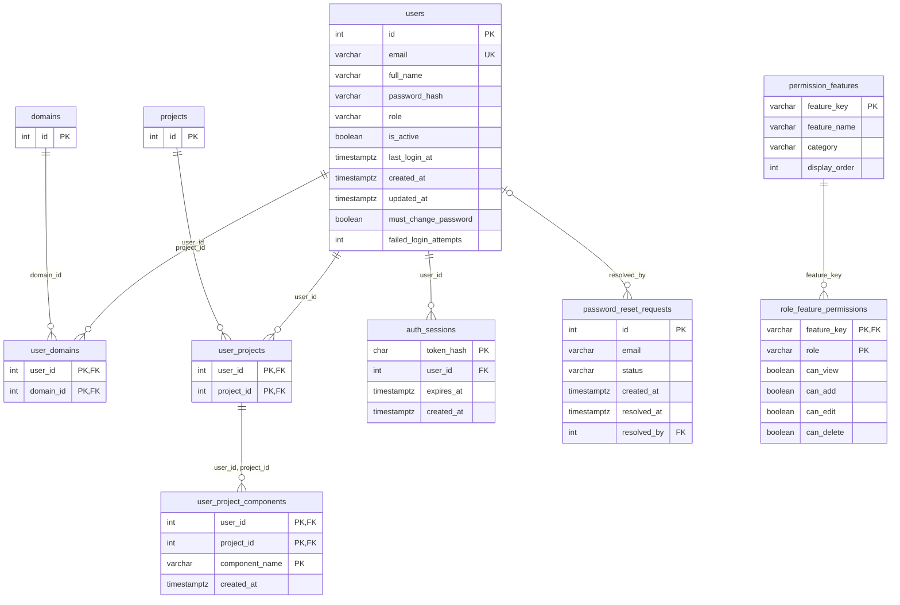

Bảng tham chiếu ngoài nhóm (chỉ vẽ khoá chính): `domains`, `projects`.

### `users`

Quản lý tài khoản người dùng, băm mật khẩu bcrypt. Cột `role` nhận CHECK 4 giá trị: SUPERADMIN, ADMIN, SUPERVISOR, USER.

| Cột | Kiểu | Null | Mặc định | Khoá | Ghi chú |
|---|---|---|---|---|---|
| `id` | int (tự tăng) | không |  | PK | Mã định danh tự tăng |
| `email` | varchar(255) | không |  | UK | Email đăng nhập hệ thống (không dùng username riêng) |
| `full_name` | varchar(255) | không |  |  | Họ tên đầy đủ người dùng |
| `password_hash` | varchar(255) | không |  |  | Mật khẩu đã băm bằng bcrypt |
| `role` | varchar(20) | không |  |  | 4 vai trò cố định của hệ thống |
| `is_active` | boolean | không | true |  | Trạng thái hoạt động |
| `last_login_at` | timestamptz | có |  |  | Thời điểm đăng nhập gần nhất |
| `created_at` | timestamptz | có | CURRENT_TIMESTAMP |  |  |
| `updated_at` | timestamptz | có | CURRENT_TIMESTAMP |  |  |
| `must_change_password` | boolean | không | true |  |  |
| `failed_login_attempts` | int | không | 0 |  |  |

- `users_role_check`: CHECK (((role)::text = ANY ((ARRAY['SUPERADMIN'::character varying, 'ADMIN'::character varying, 'SUPERVISOR'::character varying, 'USER'::character varying])::text[])))
- index `idx_users_unique_username`: UNIQUE btree (split_part(lower((email)::text), '@'::text, 1))

### `user_domains`

Phân quyền nhiều-nhiều giữa User và Domain nghiệp vụ (chỉ áp dụng cho ADMIN).

| Cột | Kiểu | Null | Mặc định | Khoá | Ghi chú |
|---|---|---|---|---|---|
| `user_id` | int | không |  | PK, FK → users(id) | `INT NOT NULL`PK (user_id, domain_id), FK `domains(id) ON DELETE CASCADE` |
| `domain_id` | int | không |  | PK, FK → domains(id) |  |

### `user_projects`

Phân quyền nhiều-nhiều giữa User và Dự án (cấp quyền full 1 dự án cho PM/SM).

| Cột | Kiểu | Null | Mặc định | Khoá | Ghi chú |
|---|---|---|---|---|---|
| `user_id` | int | không |  | PK, FK → users(id) | `INT NOT NULL`PK (user_id, project_id), FK `projects(id) ON DELETE CASCADE` |
| `project_id` | int | không |  | PK, FK → projects(id) |  |

- trigger `trg_user_projects_sync_project_members`

### `user_project_components`

Thu hẹp phạm vi quyền dự án của PM/SM xuống chỉ những Epic có Jira Component khớp danh sách.

| Cột | Kiểu | Null | Mặc định | Khoá | Ghi chú |
|---|---|---|---|---|---|
| `user_id` | int | không |  | PK, FK → user_projects(user_id) |  |
| `project_id` | int | không |  | PK, FK → user_projects(project_id) |  |
| `component_name` | varchar(255) | không |  | PK |  |
| `created_at` | timestamptz | có | CURRENT_TIMESTAMP |  |  |

- index `idx_user_project_components_lookup`: btree (user_id, project_id)

### `auth_sessions`

Quản lý phiên đăng nhập active bằng cookie HTTP-only (băm SHA-256).

| Cột | Kiểu | Null | Mặc định | Khoá | Ghi chú |
|---|---|---|---|---|---|
| `token_hash` | char(64) | không |  | PK | `INT NOT NULL`FK `users(id) ON DELETE CASCADE` |
| `user_id` | int | không |  | FK → users(id) |  |
| `expires_at` | timestamptz | không |  |  | `TIMESTAMP WITH TIME ZONE`DEFAULT CURRENT_TIMESTAMP |
| `created_at` | timestamptz | có | CURRENT_TIMESTAMP |  |  |

- index `idx_auth_sessions_user_expiry`: btree (user_id, expires_at)

### `password_reset_requests`

Lưu trữ yêu cầu đặt lại mật khẩu theo email. CAPTCHA xác thực trước ở tầng API.

| Cột | Kiểu | Null | Mặc định | Khoá | Ghi chú |
|---|---|---|---|---|---|
| `id` | int (tự tăng) | không |  | PK | `VARCHAR(255) NOT NULL`Email nhận yêu cầu reset |
| `email` | varchar(255) | không |  |  |  |
| `status` | varchar(20) | không | 'PENDING'::character varying |  | `INT`FK `users(id) ON DELETE SET NULL` (Admin/Superadmin xử lý) |
| `created_at` | timestamptz | có | CURRENT_TIMESTAMP |  |  |
| `resolved_at` | timestamptz | có |  |  |  |
| `resolved_by` | int | có |  | FK → users(id) |  |

- `password_reset_requests_status_check`: CHECK (((status)::text = ANY ((ARRAY['PENDING'::character varying, 'RESOLVED'::character varying])::text[])))

### `permission_features`

Danh mục các tính năng hệ thống phục vụ ma trận phân quyền.

| Cột | Kiểu | Null | Mặc định | Khoá | Ghi chú |
|---|---|---|---|---|---|
| `feature_key` | varchar(60) | không |  | PK |  |
| `feature_name` | varchar(150) | không |  |  |  |
| `category` | varchar(10) | không |  |  |  |
| `display_order` | int | không | 0 |  |  |

- `permission_features_category_check`: CHECK (((category)::text = ANY ((ARRAY['ADMIN'::character varying, 'VIEW_ONLY'::character varying])::text[])))

### `role_feature_permissions`

Bảng ma trận cấu hình 4 quyền Xem/Thêm/Sửa/Xóa theo từng (tính năng, role).

| Cột | Kiểu | Null | Mặc định | Khoá | Ghi chú |
|---|---|---|---|---|---|
| `feature_key` | varchar(60) | không |  | PK, FK → permission_features(feature_key) |  |
| `role` | varchar(20) | không |  | PK |  |
| `can_view` | boolean | không | false |  |  |
| `can_add` | boolean | không | false |  |  |
| `can_edit` | boolean | không | false |  |  |
| `can_delete` | boolean | không | false |  |  |

- `role_feature_permissions_role_check`: CHECK (((role)::text = ANY ((ARRAY['SUPERADMIN'::character varying, 'ADMIN'::character varying, 'SUPERVISOR'::character varying, 'USER'::character varying])::text[])))

## 2. Domain & Dự án

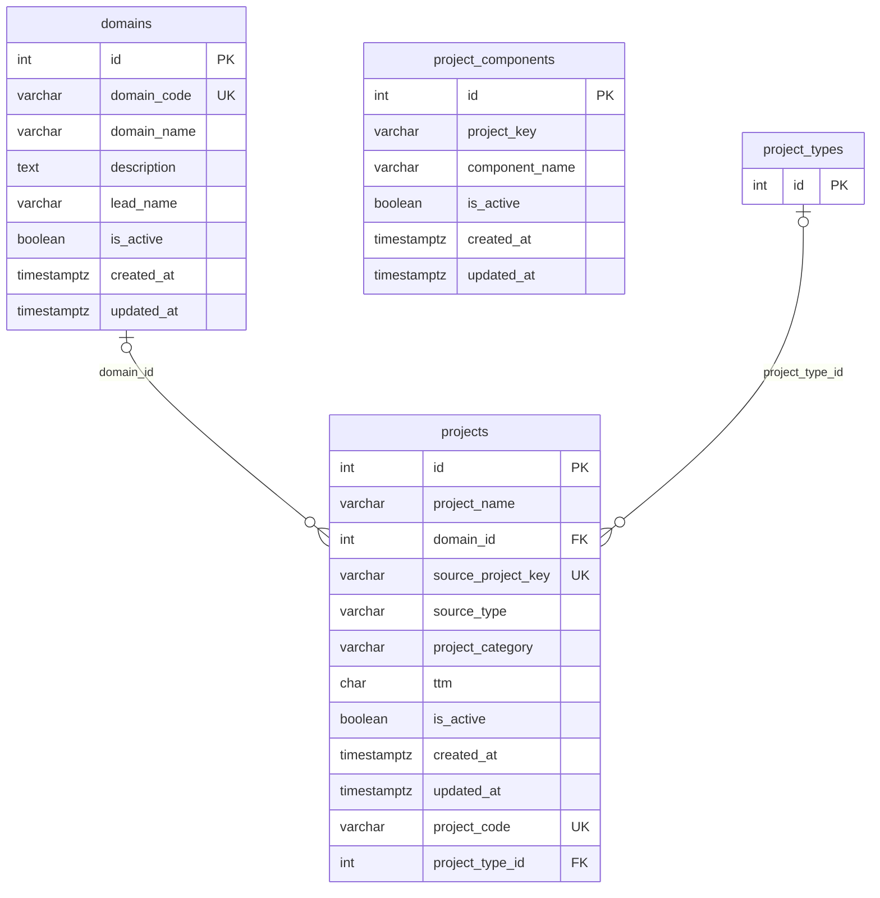

Bảng tham chiếu ngoài nhóm (chỉ vẽ khoá chính): `project_types`.

### `domains`

Danh mục Domain nghiệp vụ. Cột `lead_name` dạng text tự do.

| Cột | Kiểu | Null | Mặc định | Khoá | Ghi chú |
|---|---|---|---|---|---|
| `id` | int (tự tăng) | không |  | PK | `VARCHAR(50) NOT NULL`UNIQUE (Mã Domain nghiệp vụ) |
| `domain_code` | varchar(50) | không |  | UK |  |
| `domain_name` | varchar(255) | không |  |  | `VARCHAR(100)`Tên Trưởng Domain (dạng text tự do) |
| `description` | text | có |  |  |  |
| `lead_name` | varchar(100) | có |  |  |  |
| `is_active` | boolean | không | true |  |  |
| `created_at` | timestamptz | có | CURRENT_TIMESTAMP |  |  |
| `updated_at` | timestamptz | có | CURRENT_TIMESTAMP |  |  |

### `projects`

Danh mục Dự án. Khóa `source_project_key` duy nhất dùng để so khớp với dữ liệu import từ Jira.

| Cột | Kiểu | Null | Mặc định | Khoá | Ghi chú |
|---|---|---|---|---|---|
| `id` | int (tự tăng) | không |  | PK | `VARCHAR(255) NOT NULL`Tên Dự án |
| `project_name` | varchar(255) | không |  |  |  |
| `domain_id` | int | có |  | FK → domains(id) | `VARCHAR(50) NOT NULL`UNIQUE, khóa duy nhất so khớp với Jira CSV |
| `source_project_key` | varchar(50) | không |  | UK |  |
| `source_type` | varchar(50) | không | 'JIRA'::character varying |  | `VARCHAR(30)`CHECK ('Dự án', 'Team Agile', 'Team Triển khai') |
| `project_category` | varchar(30) | có |  |  |  |
| `ttm` | char(1) | không | 'N'::bpchar |  |  |
| `is_active` | boolean | không | true |  |  |
| `created_at` | timestamptz | có | CURRENT_TIMESTAMP |  |  |
| `updated_at` | timestamptz | có | CURRENT_TIMESTAMP |  |  |
| `project_code` | varchar(50) | không |  | UK |  |
| `project_type_id` | int | có |  | FK → project_types(id) |  |

- `projects_project_category_check`: CHECK (((project_category)::text = ANY ((ARRAY['Dự án'::character varying, 'Team Agile'::character varying, 'Team Triển khai'::character varying])::text[])))
- `projects_ttm_check`: CHECK ((ttm = ANY (ARRAY['Y'::bpchar, 'N'::bpchar])))
- index `idx_projects_project_type`: btree (project_type_id)
- index `idx_projects_source_key`: btree (source_project_key)
- trigger `trg_projects_fill_project_code`
- trigger `trg_projects_sync_pms_tables`
- trigger `trg_projects_sync_project_type`

### `project_components`

Tích lũy tự động các Jira Component đọc được từ CSV import để phục vụ dropdown lọc.

| Cột | Kiểu | Null | Mặc định | Khoá | Ghi chú |
|---|---|---|---|---|---|
| `id` | int (tự tăng) | không |  | PK | `VARCHAR(50) NOT NULL`Mã Project Key (khớp `projects.source_project_key`) |
| `project_key` | varchar(50) | không |  |  |  |
| `component_name` | varchar(255) | không |  |  | `BOOLEAN NOT NULL`DEFAULT TRUE |
| `is_active` | boolean | không | true |  |  |
| `created_at` | timestamptz | có | CURRENT_TIMESTAMP |  |  |
| `updated_at` | timestamptz | có | CURRENT_TIMESTAMP |  |  |

- UNIQUE (project_key, component_name)
- index `idx_project_components_project_active`: btree (project_key, is_active)

## 3. Quản lý dự án (PMS — expand-only)

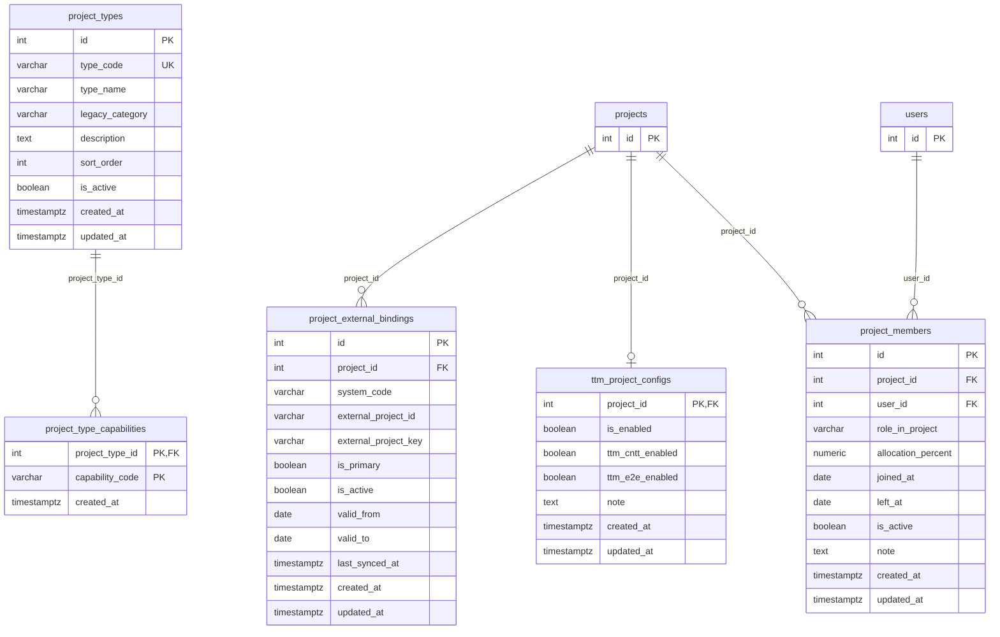

Bảng tham chiếu ngoài nhóm (chỉ vẽ khoá chính): `projects`, `users`.

### `project_types`

**PMS, 09/10/2026.** Loại dự án: Dự án / Team Agile / Team Triển khai (`legacy_category` map với `projects.project_category`). `projects` có thêm `project_code` (mã nghiệp vụ, mặc định = Jira key) và `project_type_id`.

| Cột | Kiểu | Null | Mặc định | Khoá | Ghi chú |
|---|---|---|---|---|---|
| `id` | int (tự tăng) | không |  | PK |  |
| `type_code` | varchar(50) | không |  | UK |  |
| `type_name` | varchar(100) | không |  |  |  |
| `legacy_category` | varchar(30) | có |  |  |  |
| `description` | text | có |  |  |  |
| `sort_order` | int | không | 0 |  |  |
| `is_active` | boolean | không | true |  |  |
| `created_at` | timestamptz | không | CURRENT_TIMESTAMP |  |  |
| `updated_at` | timestamptz | không | CURRENT_TIMESTAMP |  |  |

- index `uq_project_types_legacy_category`: UNIQUE btree (legacy_category) WHERE (legacy_category IS NOT NULL)

### `project_type_capabilities`

**PMS.** Năng lực theo loại dự án (Checklist, Milestone, Gantt, Kế hoạch triển khai, Kỳ kế hoạch, Backlog, Capacity).

| Cột | Kiểu | Null | Mặc định | Khoá | Ghi chú |
|---|---|---|---|---|---|
| `project_type_id` | int | không |  | PK, FK → project_types(id) |  |
| `capability_code` | varchar(50) | không |  | PK |  |
| `created_at` | timestamptz | không | CURRENT_TIMESTAMP |  |  |

### `project_external_bindings`

**PMS.** Liên kết dự án ↔ hệ thống ngoài (mặc định Jira key), có hiệu lực theo khoảng ngày; đổi Jira key của dự án sẽ đóng binding cũ và mở binding mới (trigger, từ 19/10/2026).

| Cột | Kiểu | Null | Mặc định | Khoá | Ghi chú |
|---|---|---|---|---|---|
| `id` | int (tự tăng) | không |  | PK |  |
| `project_id` | int | không |  | FK → projects(id) |  |
| `system_code` | varchar(30) | không | 'JIRA'::character varying |  |  |
| `external_project_id` | varchar(100) | có |  |  |  |
| `external_project_key` | varchar(100) | không |  |  |  |
| `is_primary` | boolean | không | true |  |  |
| `is_active` | boolean | không | true |  |  |
| `valid_from` | date | có |  |  |  |
| `valid_to` | date | có |  |  |  |
| `last_synced_at` | timestamptz | có |  |  |  |
| `created_at` | timestamptz | không | CURRENT_TIMESTAMP |  |  |
| `updated_at` | timestamptz | không | CURRENT_TIMESTAMP |  |  |

- `chk_peb_valid_range`: CHECK (((valid_to IS NULL) OR (valid_from IS NULL) OR (valid_to >= valid_from)))
- index `idx_peb_project`: btree (project_id)
- index `uq_peb_external_key_per_system`: UNIQUE btree (system_code, upper((external_project_key)::text)) WHERE is_active
- index `uq_peb_primary_per_system`: UNIQUE btree (project_id, system_code) WHERE (is_primary AND is_active)

### `ttm_project_configs`

**PMS.** Bật/tắt TTM theo dự án — trigger giữ khớp với `projects.ttm` (từ 19/10/2026); TTM hiện vẫn đọc `projects.ttm`.

| Cột | Kiểu | Null | Mặc định | Khoá | Ghi chú |
|---|---|---|---|---|---|
| `project_id` | int | không |  | PK, FK → projects(id) |  |
| `is_enabled` | boolean | không | false |  |  |
| `ttm_cntt_enabled` | boolean | không | true |  |  |
| `ttm_e2e_enabled` | boolean | không | true |  |  |
| `note` | text | có |  |  |  |
| `created_at` | timestamptz | không | CURRENT_TIMESTAMP |  |  |
| `updated_at` | timestamptz | không | CURRENT_TIMESTAMP |  |  |

- index `idx_ttm_project_configs_enabled`: btree (is_enabled) WHERE is_enabled

### `project_members`

**PMS.** Thành viên dự án và vai trò — vai trò PM_SM được trigger giữ khớp với `user_projects` (từ 19/10/2026); phân quyền hiện vẫn đọc `user_projects`.

| Cột | Kiểu | Null | Mặc định | Khoá | Ghi chú |
|---|---|---|---|---|---|
| `id` | int (tự tăng) | không |  | PK |  |
| `project_id` | int | không |  | FK → projects(id) |  |
| `user_id` | int | không |  | FK → users(id) |  |
| `role_in_project` | varchar(50) | không | 'MEMBER'::character varying |  |  |
| `allocation_percent` | numeric(5,2) | có |  |  |  |
| `joined_at` | date | có |  |  |  |
| `left_at` | date | có |  |  |  |
| `is_active` | boolean | không | true |  |  |
| `note` | text | có |  |  |  |
| `created_at` | timestamptz | không | CURRENT_TIMESTAMP |  |  |
| `updated_at` | timestamptz | không | CURRENT_TIMESTAMP |  |  |

- `chk_pm_allocation`: CHECK (((allocation_percent IS NULL) OR ((allocation_percent >= (0)::numeric) AND (allocation_percent <= (100)::numeric))))
- `chk_pm_dates`: CHECK (((left_at IS NULL) OR (joined_at IS NULL) OR (left_at >= joined_at)))
- index `idx_project_members_project`: btree (project_id)
- index `idx_project_members_user`: btree (user_id)
- index `uq_project_members_active_role`: UNIQUE btree (project_id, user_id, role_in_project) WHERE is_active

## 4. Import & Issue

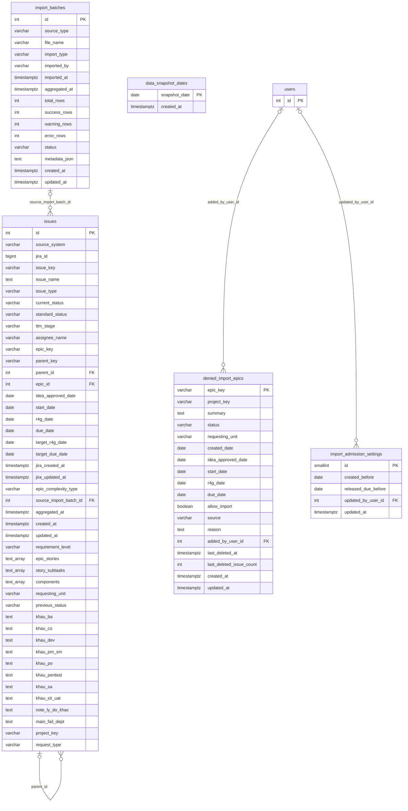

Bảng tham chiếu ngoài nhóm (chỉ vẽ khoá chính): `users`.

### `import_batches`

Quản lý từng đợt import CSV (metadata đợt import, mốc `aggregated_at`, số dòng thành công/lỗi).

| Cột | Kiểu | Null | Mặc định | Khoá | Ghi chú |
|---|---|---|---|---|---|
| `id` | int (tự tăng) | không |  | PK | `VARCHAR(255) NOT NULL`Tên file CSV import gốc |
| `source_type` | varchar(50) | có | 'CSV'::character varying |  |  |
| `file_name` | varchar(255) | không |  |  |  |
| `import_type` | varchar(50) | có | 'MANUAL'::character varying |  | `TIMESTAMP WITH TIME ZONE NOT NULL`Mốc thời gian lớp dữ liệu snapshot tổng hợp |
| `imported_by` | varchar(100) | có | 'System'::character varying |  |  |
| `imported_at` | timestamptz | có | CURRENT_TIMESTAMP |  |  |
| `aggregated_at` | timestamptz | không |  |  |  |
| `total_rows` | int | có | 0 |  |  |
| `success_rows` | int | có | 0 |  |  |
| `warning_rows` | int | có | 0 |  |  |
| `error_rows` | int | có | 0 |  |  |
| `status` | varchar(50) | không |  |  |  |
| `metadata_json` | text | có |  |  |  |
| `created_at` | timestamptz | có | CURRENT_TIMESTAMP |  |  |
| `updated_at` | timestamptz | có | CURRENT_TIMESTAMP |  |  |

### `data_snapshot_dates`

**Mới 27/10/2026.** Các ngày mốc cố định của lịch sử `issues`: ngày làm việc cuối mỗi tuần, ghi một lần khi tuần đã qua. Vùng thưa của `issues` chỉ giữ phiên bản đang có hiệu lực vào các ngày này (xem mục 6.1).

| Cột | Kiểu | Null | Mặc định | Khoá | Ghi chú |
|---|---|---|---|---|---|
| `snapshot_date` | date | không |  | PK |  |
| `created_at` | timestamptz | không | CURRENT_TIMESTAMP |  |  |

### `issues`

Bảng canonical lưu trữ toàn bộ issue mọi cấp (Epic/Story/Subtask). Ghi nhận các mốc T0 (idea_approved_date), T1 (start_date), R4G (r4g_date), Due (due_date) và 4 Epic Type. Self-FK `parent_id` & `epic_id`.

| Cột | Kiểu | Null | Mặc định | Khoá | Ghi chú |
|---|---|---|---|---|---|
| `id` | int (tự tăng) | không |  | PK | `BIGINT NOT NULL`ID gốc của Issue trên hệ thống Jira |
| `source_system` | varchar(50) | có | 'JIRA'::character varying |  |  |
| `jira_id` | bigint | không |  |  |  |
| `issue_key` | varchar(50) | không |  |  | `TEXT NOT NULL`Tóm tắt / Tên issue |
| `issue_name` | text | không |  |  |  |
| `issue_type` | varchar(50) | không |  |  | `VARCHAR(50) NOT NULL`Trạng thái hiện tại từ Jira |
| `current_status` | varchar(50) | không |  |  |  |
| `standard_status` | varchar(50) | có |  |  |  |
| `ttm_stage` | varchar(50) | có |  |  |  |
| `assignee_name` | varchar(100) | có |  |  |  |
| `epic_key` | varchar(50) | có |  |  |  |
| `parent_key` | varchar(50) | có |  |  |  |
| `parent_id` | int | có |  | FK → issues(id) | `INT`Self-FK `issues(id) ON DELETE SET NULL` (Subtask → Epic) |
| `epic_id` | int | có |  | FK → issues(id) |  |
| `idea_approved_date` | date | có |  |  | `DATE`Mốc T1 (Bắt đầu TTM-CNTT) |
| `start_date` | date | có |  |  |  |
| `r4g_date` | date | có |  |  | `DATE`Mốc Due Date (Kết thúc TTM-E2E) |
| `due_date` | date | có |  |  |  |
| `target_r4g_date` | date | có |  |  |  |
| `target_due_date` | date | có |  |  |  |
| `jira_created_at` | timestamptz | có |  |  |  |
| `jira_updated_at` | timestamptz | có |  |  |  |
| `epic_complexity_type` | varchar(50) | có |  |  | `VARCHAR(50)`Mức yêu cầu từ Jira (1, 2, 3, 4) |
| `source_import_batch_id` | int | có |  | FK → import_batches(id) | `TIMESTAMP WITH TIME ZONE NOT NULL`Thời điểm chốt lớp dữ liệu |
| `aggregated_at` | timestamptz | không |  |  |  |
| `created_at` | timestamptz | có | CURRENT_TIMESTAMP |  |  |
| `updated_at` | timestamptz | có | CURRENT_TIMESTAMP |  |  |
| `requirement_level` | varchar(100) | có |  |  |  |
| `epic_stories` | text[] | có |  |  |  |
| `story_subtasks` | text[] | có |  |  |  |
| `components` | text[] | có |  |  | `TEXT[]`Mảng lưu danh sách key con trực tiếp |
| `requesting_unit` | varchar(255) | có |  |  |  |
| `previous_status` | varchar(50) | có |  |  | `TEXT`Thông tin vai trò nguyên nhân Fail TTM-CNTT theo từng khâu & Ghi chú lý do khác |
| `khau_ba` | text | có |  |  |  |
| `khau_co` | text | có |  |  |  |
| `khau_dev` | text | có |  |  |  |
| `khau_pm_sm` | text | có |  |  |  |
| `khau_po` | text | có |  |  |  |
| `khau_pentest` | text | có |  |  |  |
| `khau_sa` | text | có |  |  |  |
| `khau_sit_uat` | text | có |  |  |  |
| `note_ly_do_khac` | text | có |  |  |  |
| `main_fail_dept` | text | có |  |  |  |
| `project_key` | varchar(100) | có |  |  |  |
| `request_type` | varchar(255) | có |  |  |  |

- index `idx_issues_aggregated_at`: btree (aggregated_at)
- index `idx_issues_batch_id`: btree (source_import_batch_id)
- index `idx_issues_epic_id`: btree (epic_id) WHERE (epic_id IS NOT NULL)
- index `idx_issues_epic_key_aggregated_at`: btree (epic_key, aggregated_at DESC) WHERE (epic_key IS NOT NULL)
- index `idx_issues_key_aggregated_at`: btree (issue_key, aggregated_at DESC)
- index `idx_issues_key_batch`: UNIQUE btree (issue_key, source_import_batch_id)
- index `idx_issues_parent_id`: btree (parent_id) WHERE (parent_id IS NOT NULL)
- index `idx_issues_parent_key`: btree (parent_key) WHERE (parent_key IS NOT NULL)
- index `idx_issues_type_status`: btree (issue_type, current_status)

### `denied_import_epics`

**Mới 14/10/2026.** "Từ chối import": Epic không được đưa vào CSDL. Lưu thông tin cơ bản chụp lúc thêm (summary, status, đơn vị yêu cầu, created, ngày duyệt ý tưởng, start, R4G, due), `allow_import` ("Cho phép import" — miễn trừ rule tự động), `source` (`MANUAL` / `AUTO_RULE` / `SEED`), lý do, lần xóa dữ liệu gần nhất — mục 3.4.

| Cột | Kiểu | Null | Mặc định | Khoá | Ghi chú |
|---|---|---|---|---|---|
| `epic_key` | varchar(100) | không |  | PK |  |
| `project_key` | varchar(50) | có |  |  |  |
| `summary` | text | có |  |  |  |
| `status` | varchar(100) | có |  |  |  |
| `requesting_unit` | varchar(255) | có |  |  |  |
| `created_date` | date | có |  |  |  |
| `idea_approved_date` | date | có |  |  |  |
| `start_date` | date | có |  |  |  |
| `r4g_date` | date | có |  |  |  |
| `due_date` | date | có |  |  |  |
| `allow_import` | boolean | không | false |  |  |
| `source` | varchar(20) | không | 'MANUAL'::character varying |  |  |
| `reason` | text | có |  |  |  |
| `added_by_user_id` | int | có |  | FK → users(id) |  |
| `last_deleted_at` | timestamptz | có |  |  |  |
| `last_deleted_issue_count` | int | có |  |  |  |
| `created_at` | timestamptz | không | CURRENT_TIMESTAMP |  |  |
| `updated_at` | timestamptz | không | CURRENT_TIMESTAMP |  |  |

- `denied_import_epics_source_check`: CHECK (((source)::text = ANY ((ARRAY['MANUAL'::character varying, 'AUTO_RULE'::character varying, 'SEED'::character varying, 'AUTO_EXEMPT'::character varying])::text[])))
- index `idx_denied_import_epics_project_key`: btree (project_key)

### `import_admission_settings`

**Mới 14/10/2026.** Ngày A (`created_before`) và ngày B (`released_due_before`) của rule tự động Từ chối import; để trống = tắt rule — mục 3.4.

| Cột | Kiểu | Null | Mặc định | Khoá | Ghi chú |
|---|---|---|---|---|---|
| `id` | smallint | không | 1 | PK |  |
| `created_before` | date | có |  |  |  |
| `released_due_before` | date | có |  |  |  |
| `updated_by_user_id` | int | có |  | FK → users(id) |  |
| `updated_at` | timestamptz | không | CURRENT_TIMESTAMP |  |  |

- `import_admission_settings_id_check`: CHECK ((id = 1))

## 5. Cấu hình TTM, lịch & phạm vi

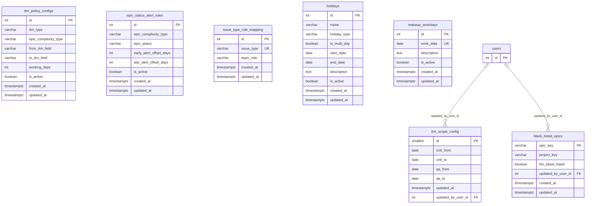

Bảng tham chiếu ngoài nhóm (chỉ vẽ khoá chính): `users`.

### `ttm_policy_configs`

Tiêu chí mốc hạn TTM chuẩn (TTM-CNTT và TTM-E2E) cho 4 loại Epic Type.

| Cột | Kiểu | Null | Mặc định | Khoá | Ghi chú |
|---|---|---|---|---|---|
| `id` | int (tự tăng) | không |  | PK |  |
| `ttm_type` | varchar(20) | không |  |  | `VARCHAR(20) NOT NULL`CHECK ('SIMPLE', 'COMPLEX', 'CT-Lv12', 'CT-Lv34', 'SP-Lv12', 'SP-Lv34') |
| `epic_complexity_type` | varchar(20) | không |  |  |  |
| `from_ttm_field` | varchar(100) | không |  |  | `VARCHAR(50) NOT NULL`CHECK ('R4G_DATE', 'DUE_DATE') |
| `to_ttm_field` | varchar(100) | không |  |  |  |
| `working_days` | int | không |  |  |  |
| `is_active` | boolean | không | true |  |  |
| `created_at` | timestamptz | không | CURRENT_TIMESTAMP |  |  |
| `updated_at` | timestamptz | không | CURRENT_TIMESTAMP |  |  |

- UNIQUE (ttm_type, epic_complexity_type)
- `ttm_policy_configs_epic_complexity_type_check`: CHECK (((epic_complexity_type)::text = ANY ((ARRAY['SIMPLE'::character varying, 'COMPLEX'::character varying, 'CT-Lv12'::character varying, 'CT-Lv34'::character varying, 'SP-Lv12'::character varying, 'SP-Lv34'::character varying])::text[])))
- `ttm_policy_configs_ttm_type_check`: CHECK (((ttm_type)::text = ANY ((ARRAY['TTM_CNTT'::character varying, 'TTM_E2E'::character varying])::text[])))
- `ttm_policy_configs_working_days_check`: CHECK (((working_days > 0) AND (working_days <= 3650)))

### `epic_status_alert_rules`

Quy tắc mốc Cảnh báo sớm/muộn (số ngày làm việc từ T1) cho từng cặp (Loại Epic × Trạng thái).

| Cột | Kiểu | Null | Mặc định | Khoá | Ghi chú |
|---|---|---|---|---|---|
| `id` | int (tự tăng) | không |  | PK |  |
| `epic_complexity_type` | varchar(20) | không |  |  | `VARCHAR(50) NOT NULL`Trạng thái Epic (Design, In Progress, DEV, TEST...) |
| `epic_status` | varchar(50) | không |  |  |  |
| `early_alert_offset_days` | int | không |  |  | `INT NOT NULL`CHECK (>= 0) — Mốc Cảnh báo muộn (ngày làm việc) |
| `late_alert_offset_days` | int | không |  |  |  |
| `is_active` | boolean | không | true |  |  |
| `created_at` | timestamptz | có | CURRENT_TIMESTAMP |  |  |
| `updated_at` | timestamptz | có | CURRENT_TIMESTAMP |  |  |

- UNIQUE (epic_complexity_type, epic_status)
- `epic_status_alert_rules_early_alert_offset_days_check`: CHECK ((early_alert_offset_days >= 0))
- `epic_status_alert_rules_epic_complexity_type_check`: CHECK (((epic_complexity_type)::text = ANY ((ARRAY['SIMPLE'::character varying, 'COMPLEX'::character varying, 'CT-Lv12'::character varying, 'CT-Lv34'::character varying, 'SP-Lv12'::character varying, 'SP-Lv34'::character varying])::text[])))
- `epic_status_alert_rules_late_alert_offset_days_check`: CHECK ((late_alert_offset_days >= 0))
- index `idx_epic_status_alert_rules_active`: btree (is_active) WHERE is_active

### `issue_type_role_mapping`

Mapping loại Subtask Jira sang team-role BA/DEV/TEST/PM để xác định hoàn thành pha.

| Cột | Kiểu | Null | Mặc định | Khoá | Ghi chú |
|---|---|---|---|---|---|
| `id` | int (tự tăng) | không |  | PK |  |
| `issue_type` | varchar(100) | không |  | UK | `VARCHAR(20) NOT NULL`CHECK ('BA', 'DEV', 'TEST', 'PM') |
| `team_role` | varchar(10) | không |  |  |  |
| `created_at` | timestamptz | có | CURRENT_TIMESTAMP |  |  |
| `updated_at` | timestamptz | có | CURRENT_TIMESTAMP |  |  |

- `issue_type_role_mapping_team_role_check`: CHECK (((team_role)::text = ANY ((ARRAY['BA'::character varying, 'DEV'::character varying, 'TEST'::character varying, 'PM'::character varying])::text[])))
- index `idx_issue_type_role_mapping_role`: btree (team_role)

### `ttm_scope_config`

"Phạm vi dữ liệu cho TTM": khoảng ngày R4G for TTM (CNTT) và (QA) — mục 8.7.

| Cột | Kiểu | Null | Mặc định | Khoá | Ghi chú |
|---|---|---|---|---|---|
| `id` | smallint | không | 1 | PK |  |
| `cntt_from` | date | có |  |  |  |
| `cntt_to` | date | có |  |  |  |
| `qa_from` | date | có |  |  |  |
| `qa_to` | date | có |  |  |  |
| `updated_at` | timestamptz | không | CURRENT_TIMESTAMP |  |  |
| `updated_by_user_id` | int | có |  | FK → users(id) |  |

- `ttm_scope_config_id_check`: CHECK ((id = 1))

### `holidays`

Danh mục ngày nghỉ lễ/nghỉ công ty dùng để loại trừ khi tính số ngày làm việc.

| Cột | Kiểu | Null | Mặc định | Khoá | Ghi chú |
|---|---|---|---|---|---|
| `id` | int (tự tăng) | không |  | PK |  |
| `name` | varchar(255) | không |  |  |  |
| `holiday_type` | varchar(50) | không | 'COMPANY'::character varying |  |  |
| `is_multi_day` | boolean | không | false |  |  |
| `start_date` | date | không |  |  |  |
| `end_date` | date | không |  |  |  |
| `description` | text | có |  |  |  |
| `is_active` | boolean | không | true |  |  |
| `created_at` | timestamptz | có | CURRENT_TIMESTAMP |  |  |
| `updated_at` | timestamptz | có | CURRENT_TIMESTAMP |  |  |

- `chk_holiday_date_range`: CHECK ((end_date >= start_date))
- index `idx_holidays_range`: btree (start_date, end_date) WHERE is_active

### `makeup_workdays`

Danh mục "Ngày làm bù": khai báo một ngày T7/CN cụ thể là ngày làm việc bình thường.

| Cột | Kiểu | Null | Mặc định | Khoá | Ghi chú |
|---|---|---|---|---|---|
| `id` | int (tự tăng) | không |  | PK |  |
| `work_date` | date | không |  | UK |  |
| `description` | text | có |  |  |  |
| `is_active` | boolean | không | true |  |  |
| `created_at` | timestamptz | có | CURRENT_TIMESTAMP |  |  |
| `updated_at` | timestamptz | có | CURRENT_TIMESTAMP |  |  |

- index `idx_makeup_workdays_active`: btree (work_date) WHERE is_active

### `black_listed_epics`

**Mới 05/10/2026.** "Epic ngoại lệ": mỗi dòng là 1 Epic bị loại khỏi mọi phép tính Time to Market (`project_key`, `ttm_black_listed`, người cập nhật). Bỏ ngoại lệ = xoá dòng — mục 13.4.

| Cột | Kiểu | Null | Mặc định | Khoá | Ghi chú |
|---|---|---|---|---|---|
| `epic_key` | varchar(100) | không |  | PK |  |
| `project_key` | varchar(50) | không |  |  |  |
| `ttm_black_listed` | boolean | không | true |  |  |
| `updated_by_user_id` | int | có |  | FK → users(id) |  |
| `created_at` | timestamptz | không | CURRENT_TIMESTAMP |  |  |
| `updated_at` | timestamptz | không | CURRENT_TIMESTAMP |  |  |

- index `idx_black_listed_epics_project_key`: btree (project_key)

## 6. Epic Scoring Service

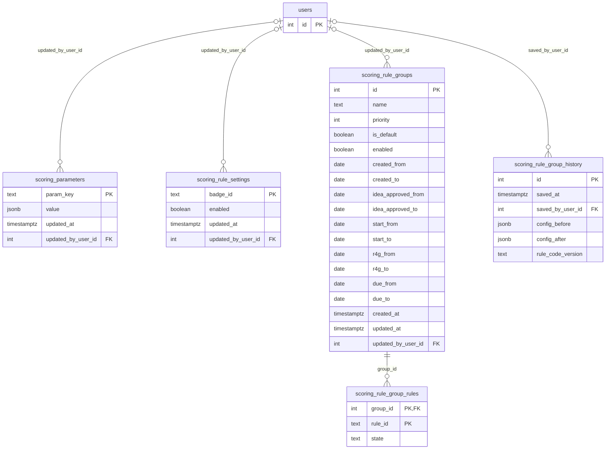

Bảng tham chiếu ngoài nhóm (chỉ vẽ khoá chính): `users`.

### `scoring_parameters`

Tham số rule do admin ghi đè (grace Release, tỉ lệ Pending lâu, status được miễn…); mặc định nằm trong code.

| Cột | Kiểu | Null | Mặc định | Khoá | Ghi chú |
|---|---|---|---|---|---|
| `param_key` | text | không |  | PK |  |
| `value` | jsonb | không |  |  |  |
| `updated_at` | timestamptz | không | CURRENT_TIMESTAMP |  |  |
| `updated_by_user_id` | int | có |  | FK → users(id) |  |

### `scoring_rule_settings`

**Không còn dùng từ 25/10/2026** (thay bằng Rule Group — Rule Management); chờ gỡ bảng. Trước đây: bật/tắt từng badge của Scoring Service.

| Cột | Kiểu | Null | Mặc định | Khoá | Ghi chú |
|---|---|---|---|---|---|
| `badge_id` | text | không |  | PK |  |
| `enabled` | boolean | không |  |  |  |
| `updated_at` | timestamptz | không | CURRENT_TIMESTAMP |  |  |
| `updated_by_user_id` | int | có |  | FK → users(id) |  |

### `scoring_rule_groups`

**Mới 25/10/2026.** Nhóm rule (Rule Group) của Scoring Service: khoảng ngày Epic (5 cặp Từ/Đến: ngày tạo, phê duyệt ý tưởng, Start Date, R4G Date, Due Date — AND, tính cả hai đầu), thứ tự ưu tiên, bật/tắt. Epic thuộc nhóm bật ưu tiên cao nhất mà nó khớp; không khớp nhóm nào thì thuộc nhóm `is_default` (luôn có đúng một, không điều kiện ngày, đứng cuối). Màn hình Rule Management.

| Cột | Kiểu | Null | Mặc định | Khoá | Ghi chú |
|---|---|---|---|---|---|
| `id` | int (tự tăng) | không |  | PK |  |
| `name` | text | không |  |  |  |
| `priority` | int | không |  |  |  |
| `is_default` | boolean | không | false |  |  |
| `enabled` | boolean | không | true |  |  |
| `created_from` | date | có |  |  |  |
| `created_to` | date | có |  |  |  |
| `idea_approved_from` | date | có |  |  |  |
| `idea_approved_to` | date | có |  |  |  |
| `start_from` | date | có |  |  |  |
| `start_to` | date | có |  |  |  |
| `r4g_from` | date | có |  |  |  |
| `r4g_to` | date | có |  |  |  |
| `due_from` | date | có |  |  |  |
| `due_to` | date | có |  |  |  |
| `created_at` | timestamptz | không | CURRENT_TIMESTAMP |  |  |
| `updated_at` | timestamptz | không | CURRENT_TIMESTAMP |  |  |
| `updated_by_user_id` | int | có |  | FK → users(id) |  |

- `scoring_rule_groups_created_range`: CHECK (((created_from IS NULL) OR (created_to IS NULL) OR (created_from <= created_to)))
- `scoring_rule_groups_default_shape`: CHECK (((NOT is_default) OR (enabled AND (created_from IS NULL) AND (created_to IS NULL) AND (idea_approved_from IS NULL) AND (idea_approved_to IS NULL) AND (start_from IS NULL) AND (start_to IS NULL) AND (r4g_from IS NULL) AND (r4g_to IS NULL) AND (due_from IS NULL) AND (due_to IS NULL))))
- `scoring_rule_groups_due_range`: CHECK (((due_from IS NULL) OR (due_to IS NULL) OR (due_from <= due_to)))
- `scoring_rule_groups_idea_range`: CHECK (((idea_approved_from IS NULL) OR (idea_approved_to IS NULL) OR (idea_approved_from <= idea_approved_to)))
- `scoring_rule_groups_name_not_blank`: CHECK ((btrim(name) <> ''::text))
- `scoring_rule_groups_r4g_range`: CHECK (((r4g_from IS NULL) OR (r4g_to IS NULL) OR (r4g_from <= r4g_to)))
- `scoring_rule_groups_start_range`: CHECK (((start_from IS NULL) OR (start_to IS NULL) OR (start_from <= start_to)))
- index `scoring_rule_groups_name_uq`: UNIQUE btree (lower(btrim(name)))
- index `scoring_rule_groups_single_default`: UNIQUE btree (is_default) WHERE is_default

### `scoring_rule_group_rules`

**Mới 25/10/2026.** Rule object (id trong `src/lib/scoring/registry.ts`) mà mỗi nhóm rule khai báo; `state` = `ON` (Bật) hoặc `OFF` (Tắt, từ 26/10/2026) — rule nhóm không khai báo là Kế thừa từ nhóm ưu tiên thấp hơn. Rule luôn chạy không có ở đây. Id không còn trong code thì bị bỏ qua.

| Cột | Kiểu | Null | Mặc định | Khoá | Ghi chú |
|---|---|---|---|---|---|
| `group_id` | int | không |  | PK, FK → scoring_rule_groups(id) |  |
| `rule_id` | text | không |  | PK |  |
| `state` | text | không | 'ON'::text |  |  |

- `scoring_rule_group_rules_state_check`: CHECK ((state = ANY (ARRAY['ON'::text, 'OFF'::text])))

### `scoring_rule_group_history`

**Mới 25/10/2026.** Mỗi lần lưu cấu hình nhóm rule: người lưu, thời điểm, toàn bộ cấu hình trước / sau (JSON). Id mới nhất là phiên bản cấu hình — lần lưu sau phải xuất phát từ phiên bản đó.

| Cột | Kiểu | Null | Mặc định | Khoá | Ghi chú |
|---|---|---|---|---|---|
| `id` | int (tự tăng) | không |  | PK |  |
| `saved_at` | timestamptz | không | CURRENT_TIMESTAMP |  |  |
| `saved_by_user_id` | int | có |  | FK → users(id) |  |
| `config_before` | jsonb | không |  |  |  |
| `config_after` | jsonb | không |  |  |  |
| `rule_code_version` | text | không |  |  |  |

## 7. Lịch sử & snapshot

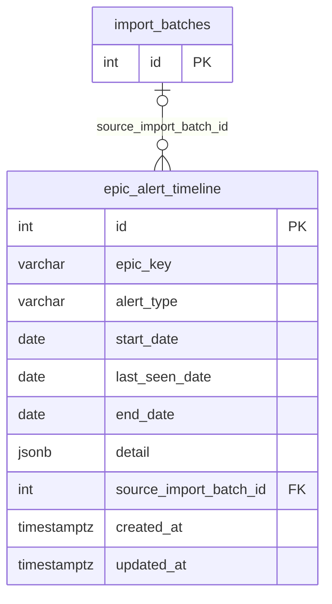

Bảng tham chiếu ngoài nhóm (chỉ vẽ khoá chính): `import_batches`.

### `epic_alert_timeline`

Theo dõi 5 loại cảnh báo dưới dạng các đợt (run) có khoảng ngày bắt đầu/kết thúc liên tục.

| Cột | Kiểu | Null | Mặc định | Khoá | Ghi chú |
|---|---|---|---|---|---|
| `id` | int (tự tăng) | không |  | PK |  |
| `epic_key` | varchar(50) | không |  |  |  |
| `alert_type` | varchar(20) | không |  |  |  |
| `start_date` | date | không |  |  |  |
| `last_seen_date` | date | không |  |  |  |
| `end_date` | date | có |  |  |  |
| `detail` | jsonb | có |  |  |  |
| `source_import_batch_id` | int | có |  | FK → import_batches(id) |  |
| `created_at` | timestamptz | có | CURRENT_TIMESTAMP |  |  |
| `updated_at` | timestamptz | có | CURRENT_TIMESTAMP |  |  |

- `epic_alert_timeline_alert_type_check`: CHECK (((alert_type)::text = ANY ((ARRAY['FAIL_TTM_CNTT'::character varying, 'LATE_TTM_CNTT'::character varying, 'FAIL_TTM_E2E'::character varying, 'MISSING_START_DATE'::character varying, 'DATA_ANOMALY'::character varying])::text[])))
- index `idx_epic_alert_timeline_end_date`: btree (end_date)
- index `idx_epic_alert_timeline_epic_key`: btree (epic_key)
- index `idx_epic_alert_timeline_open_run`: UNIQUE btree (epic_key, alert_type) WHERE (end_date IS NULL)

## 8. Cache dữ liệu dẫn xuất

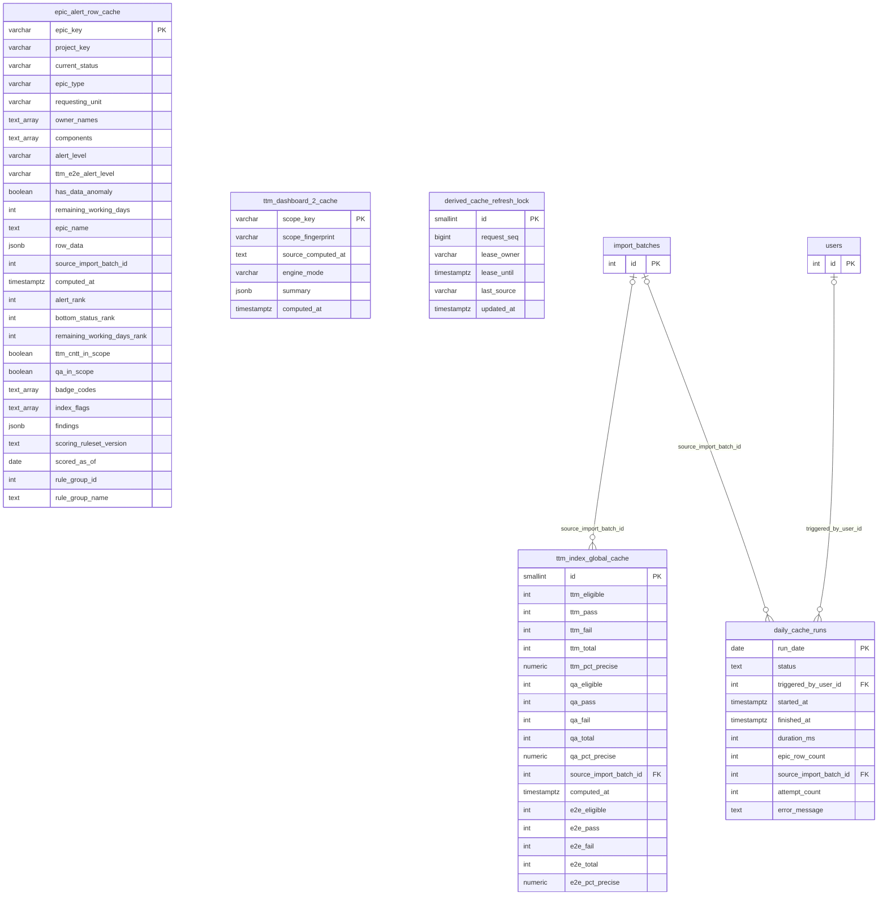

Bảng tham chiếu ngoài nhóm (chỉ vẽ khoá chính): `import_batches`, `users`.

### `epic_alert_row_cache`

Cache dòng Epic của lớp dữ liệu mới nhất cho Quản trị Epic / các Dashboard: `row_data` (JSON) + các cột lọc/sắp xếp, `badge_codes`, `index_flags`, `findings` của Scoring Service. Dựng lại sau import, đầu ngày và khi cấu hình đổi (mục 6.4).

| Cột | Kiểu | Null | Mặc định | Khoá | Ghi chú |
|---|---|---|---|---|---|
| `epic_key` | varchar(40) | không |  | PK |  |
| `project_key` | varchar(40) | không | ''::character varying |  |  |
| `current_status` | varchar(100) | không | ''::character varying |  |  |
| `epic_type` | varchar(60) | không | ''::character varying |  |  |
| `requesting_unit` | varchar(200) | có |  |  |  |
| `owner_names` | text[] | không | '{}'::text[] |  |  |
| `components` | text[] | không | '{}'::text[] |  |  |
| `alert_level` | varchar(10) | không | 'NONE'::character varying |  |  |
| `ttm_e2e_alert_level` | varchar(10) | không | 'NONE'::character varying |  |  |
| `has_data_anomaly` | boolean | không | false |  |  |
| `remaining_working_days` | int | có |  |  |  |
| `epic_name` | text | không | ''::text |  |  |
| `row_data` | jsonb | không |  |  |  |
| `source_import_batch_id` | int | có |  |  |  |
| `computed_at` | timestamptz | không | now() |  |  |
| `alert_rank` | int | không | 3 |  |  |
| `bottom_status_rank` | int | không | 0 |  |  |
| `remaining_working_days_rank` | int | không | 2147483647 |  |  |
| `ttm_cntt_in_scope` | boolean | không | true |  |  |
| `qa_in_scope` | boolean | không | true |  |  |
| `badge_codes` | text[] | không | '{}'::text[] |  |  |
| `index_flags` | text[] | không | '{}'::text[] |  |  |
| `findings` | jsonb | không | '[]'::jsonb |  |  |
| `scoring_ruleset_version` | text | có |  |  |  |
| `scored_as_of` | date | có |  |  |  |
| `rule_group_id` | int | có |  |  |  |
| `rule_group_name` | text | có |  |  |  |

- index `idx_epic_alert_row_cache_alert_level`: btree (alert_level)
- index `idx_epic_alert_row_cache_badge_codes`: gin (badge_codes)
- index `idx_epic_alert_row_cache_current_status`: btree (current_status)
- index `idx_epic_alert_row_cache_index_flags`: gin (index_flags)
- index `idx_epic_alert_row_cache_project_key`: btree (project_key)
- index `idx_epic_alert_row_cache_rule_group`: btree (rule_group_id)
- index `idx_epic_alert_row_cache_sort`: btree (bottom_status_rank, has_data_anomaly, alert_rank, remaining_working_days_rank)
- index `idx_epic_alert_row_cache_ttm_cntt_in_scope`: btree (ttm_cntt_in_scope)

### `ttm_index_global_cache`

Chỉ số toàn công ty TTM-CNTT (QLDA), TTM-CNTT (QA), TTM-E2E (số đếm + %) hiển thị trên banner.

| Cột | Kiểu | Null | Mặc định | Khoá | Ghi chú |
|---|---|---|---|---|---|
| `id` | smallint | không | 1 | PK |  |
| `ttm_eligible` | int | không |  |  |  |
| `ttm_pass` | int | không |  |  |  |
| `ttm_fail` | int | không |  |  |  |
| `ttm_total` | int | không |  |  |  |
| `ttm_pct_precise` | numeric(6,3) | không |  |  |  |
| `qa_eligible` | int | không |  |  |  |
| `qa_pass` | int | không |  |  |  |
| `qa_fail` | int | không |  |  |  |
| `qa_total` | int | không |  |  |  |
| `qa_pct_precise` | numeric(6,3) | không |  |  |  |
| `source_import_batch_id` | int | có |  | FK → import_batches(id) |  |
| `computed_at` | timestamptz | không | CURRENT_TIMESTAMP |  |  |
| `e2e_eligible` | int | không | 0 |  |  |
| `e2e_pass` | int | không | 0 |  |  |
| `e2e_fail` | int | không | 0 |  |  |
| `e2e_total` | int | không | 0 |  |  |
| `e2e_pct_precise` | numeric(6,3) | không | 0 |  |  |

- `ttm_index_global_cache_id_check`: CHECK ((id = 1))

### `ttm_dashboard_2_cache`

Số liệu phễu / widget / ma trận / pie chart chưa lọc của TTM Dashboard 2 theo phạm vi quyền (`ALL`, `ADMIN:<id>`, `USER:<id>`) — mục 21.5.

| Cột | Kiểu | Null | Mặc định | Khoá | Ghi chú |
|---|---|---|---|---|---|
| `scope_key` | varchar(64) | không |  | PK |  |
| `scope_fingerprint` | varchar(64) | không |  |  |  |
| `source_computed_at` | text | có |  |  |  |
| `engine_mode` | varchar(16) | không |  |  |  |
| `summary` | jsonb | không |  |  |  |
| `computed_at` | timestamptz | không | CURRENT_TIMESTAMP |  |  |

### `daily_cache_runs`

Mỗi ngày (giờ Việt Nam) 1 dòng: lượt tạo lại cache đầu ngày do lần tải trang đầu tiên kích hoạt (RUNNING / SUCCESS / FAILED, thời lượng, số Epic).

| Cột | Kiểu | Null | Mặc định | Khoá | Ghi chú |
|---|---|---|---|---|---|
| `run_date` | date | không |  | PK |  |
| `status` | text | không |  |  |  |
| `triggered_by_user_id` | int | có |  | FK → users(id) |  |
| `started_at` | timestamptz | không | CURRENT_TIMESTAMP |  |  |
| `finished_at` | timestamptz | có |  |  |  |
| `duration_ms` | int | có |  |  |  |
| `epic_row_count` | int | có |  |  |  |
| `source_import_batch_id` | int | có |  | FK → import_batches(id) |  |
| `attempt_count` | int | không | 1 |  |  |
| `error_message` | text | có |  |  |  |

- `daily_cache_runs_status_check`: CHECK ((status = ANY (ARRAY['RUNNING'::text, 'SUCCESS'::text, 'FAILED'::text])))

### `derived_cache_refresh_lock`

**Mới 05/10/2026.** Khoá (lease) điều phối việc tạo lại cache giữa các instance: `request_seq`, `lease_owner`, `lease_until`, `last_source` — mục 6.4.

| Cột | Kiểu | Null | Mặc định | Khoá | Ghi chú |
|---|---|---|---|---|---|
| `id` | smallint | không | 1 | PK |  |
| `request_seq` | bigint | không | 0 |  |  |
| `lease_owner` | varchar(64) | có |  |  |  |
| `lease_until` | timestamptz | có |  |  |  |
| `last_source` | varchar(100) | có |  |  |  |
| `updated_at` | timestamptz | không | CURRENT_TIMESTAMP |  |  |

- `derived_cache_refresh_lock_id_check`: CHECK ((id = 1))

## 9. Cấu hình hệ thống

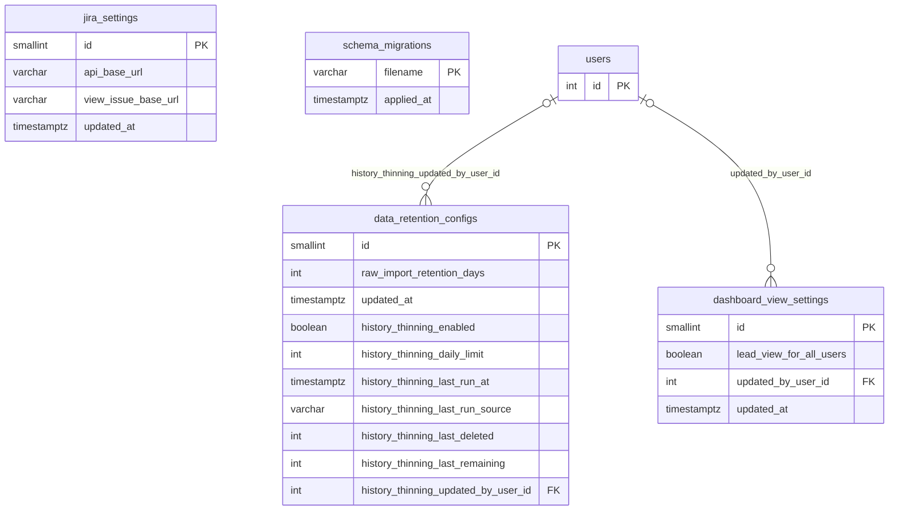

Bảng tham chiếu ngoài nhóm (chỉ vẽ khoá chính): `users`.

### `jira_settings`

Hai bảng cấu hình singleton lưu Cấu hình tích hợp Jira và số ngày lưu giữ dữ liệu raw import.

| Cột | Kiểu | Null | Mặc định | Khoá | Ghi chú |
|---|---|---|---|---|---|
| `id` | smallint | không | 1 | PK |  |
| `api_base_url` | varchar(500) | không | ''::character varying |  |  |
| `view_issue_base_url` | varchar(500) | không | ''::character varying |  |  |
| `updated_at` | timestamptz | có | CURRENT_TIMESTAMP |  |  |

- `jira_settings_id_check`: CHECK ((id = 1))

### `data_retention_configs`

Hai bảng cấu hình singleton lưu Cấu hình tích hợp Jira và số ngày lưu giữ dữ liệu raw import.

| Cột | Kiểu | Null | Mặc định | Khoá | Ghi chú |
|---|---|---|---|---|---|
| `id` | smallint | không |  | PK |  |
| `raw_import_retention_days` | int | không | 30 |  |  |
| `updated_at` | timestamptz | không | CURRENT_TIMESTAMP |  |  |
| `history_thinning_enabled` | boolean | không | false |  |  |
| `history_thinning_daily_limit` | int | không | 50000 |  |  |
| `history_thinning_last_run_at` | timestamptz | có |  |  |  |
| `history_thinning_last_run_source` | varchar(10) | có |  |  |  |
| `history_thinning_last_deleted` | int | có |  |  |  |
| `history_thinning_last_remaining` | int | có |  |  |  |
| `history_thinning_updated_by_user_id` | int | có |  | FK → users(id) |  |

- `data_retention_configs_history_thinning_daily_limit_check`: CHECK (((history_thinning_daily_limit >= 1000) AND (history_thinning_daily_limit <= 1000000)))
- `data_retention_configs_history_thinning_last_run_source_check`: CHECK (((history_thinning_last_run_source IS NULL) OR ((history_thinning_last_run_source)::text = ANY ((ARRAY['DAILY'::character varying, 'MANUAL'::character varying])::text[]))))
- `data_retention_configs_id_check`: CHECK ((id = 1))
- `data_retention_configs_raw_import_retention_days_check`: CHECK (((raw_import_retention_days >= 7) AND (raw_import_retention_days <= 3650)))

### `dashboard_view_settings`

**Mới 14/10/2026.** Công tắc "Dashboard Lead view cho tất cả user" (`lead_view_for_all_users`, mặc định bật) — Quản trị hệ thống → Dashboard, mục 21.9.

| Cột | Kiểu | Null | Mặc định | Khoá | Ghi chú |
|---|---|---|---|---|---|
| `id` | smallint | không | 1 | PK |  |
| `lead_view_for_all_users` | boolean | không | true |  |  |
| `updated_by_user_id` | int | có |  | FK → users(id) |  |
| `updated_at` | timestamptz | không | CURRENT_TIMESTAMP |  |  |

- `dashboard_view_settings_id_check`: CHECK ((id = 1))

### `schema_migrations`

Sổ theo dõi migration: mỗi file `db/migrations/*.sql` đã chạy là một dòng (`filename`, `applied_at`). Do `scripts/migrate-db.js` tự tạo và ghi; file cài đặt `db/install/ttm-monitor-schema.sql` ghi sẵn toàn bộ migration đã có để DB mới chỉ nhận migration phát sinh sau.

| Cột | Kiểu | Null | Mặc định | Khoá | Ghi chú |
|---|---|---|---|---|---|
| `filename` | varchar(255) | không |  | PK |  |
| `applied_at` | timestamptz | có | CURRENT_TIMESTAMP |  |  |

## 10. Popup & Banner thông báo

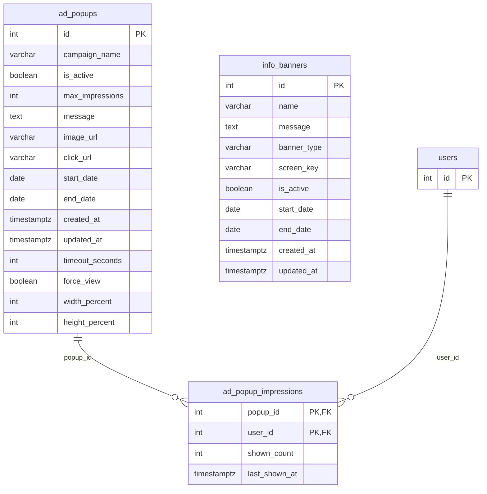

Bảng tham chiếu ngoài nhóm (chỉ vẽ khoá chính): `users`.

### `ad_popups`

Cấu hình Popup quảng cáo toàn màn hình cho mọi user đã đăng nhập (mục 14).

| Cột | Kiểu | Null | Mặc định | Khoá | Ghi chú |
|---|---|---|---|---|---|
| `id` | int (tự tăng) | không |  | PK |  |
| `campaign_name` | varchar(200) | không |  |  |  |
| `is_active` | boolean | không | true |  |  |
| `max_impressions` | int | không | 2 |  |  |
| `message` | text | không |  |  |  |
| `image_url` | varchar(500) | có |  |  |  |
| `click_url` | varchar(500) | có |  |  |  |
| `start_date` | date | không |  |  |  |
| `end_date` | date | không |  |  |  |
| `created_at` | timestamptz | không | CURRENT_TIMESTAMP |  |  |
| `updated_at` | timestamptz | không | CURRENT_TIMESTAMP |  |  |
| `timeout_seconds` | int | không | 15 |  |  |
| `force_view` | boolean | không | false |  |  |
| `width_percent` | int | có |  |  |  |
| `height_percent` | int | có |  |  |  |

- `ad_popups_height_percent_check`: CHECK (((height_percent IS NULL) OR ((height_percent >= 1) AND (height_percent <= 100))))
- `ad_popups_max_impressions_check`: CHECK ((max_impressions > 0))
- `ad_popups_timeout_seconds_check`: CHECK ((timeout_seconds > 0))
- `ad_popups_width_percent_check`: CHECK (((width_percent IS NULL) OR ((width_percent >= 1) AND (width_percent <= 100))))
- `chk_ad_popups_date_range`: CHECK ((end_date >= start_date))

### `ad_popup_impressions`

Đếm số lần một popup đã hiện cho từng user, so với `max_impressions`.

| Cột | Kiểu | Null | Mặc định | Khoá | Ghi chú |
|---|---|---|---|---|---|
| `popup_id` | int | không |  | PK, FK → ad_popups(id) |  |
| `user_id` | int | không |  | PK, FK → users(id) |  |
| `shown_count` | int | không | 0 |  |  |
| `last_shown_at` | timestamptz | có |  |  |  |

### `info_banners`

Cấu hình Banner thông báo (Mặc định toàn hệ thống hoặc theo từng màn hình, mục 15).

| Cột | Kiểu | Null | Mặc định | Khoá | Ghi chú |
|---|---|---|---|---|---|
| `id` | int (tự tăng) | không |  | PK |  |
| `name` | varchar(200) | không |  |  |  |
| `message` | text | không |  |  |  |
| `banner_type` | varchar(20) | không |  |  |  |
| `screen_key` | varchar(200) | có |  |  |  |
| `is_active` | boolean | không | true |  |  |
| `start_date` | date | không |  |  |  |
| `end_date` | date | có |  |  |  |
| `created_at` | timestamptz | không | CURRENT_TIMESTAMP |  |  |
| `updated_at` | timestamptz | không | CURRENT_TIMESTAMP |  |  |

- `chk_info_banners_date_range`: CHECK (((end_date IS NULL) OR (end_date >= start_date)))
- `info_banners_banner_type_check`: CHECK (((banner_type)::text = ANY ((ARRAY['DEFAULT'::character varying, 'PER_SCREEN'::character varying])::text[])))
- index `uq_info_banners_single_default`: UNIQUE btree (banner_type) WHERE ((banner_type)::text = 'DEFAULT'::text)

## 11. SSO, API Key & MCP Server

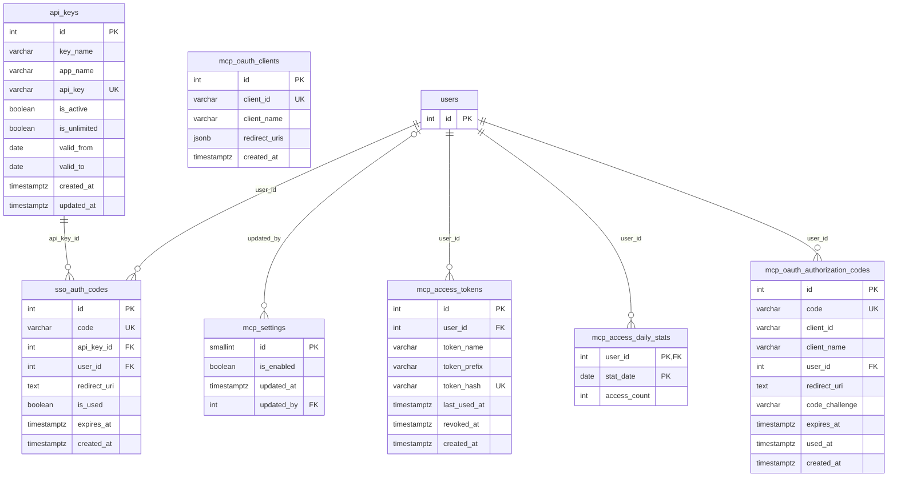

Bảng tham chiếu ngoài nhóm (chỉ vẽ khoá chính): `users`.

### `api_keys`

API key cấp cho ứng dụng ngoài dùng làm client_id trong luồng SSO (mục 17).

| Cột | Kiểu | Null | Mặc định | Khoá | Ghi chú |
|---|---|---|---|---|---|
| `id` | int (tự tăng) | không |  | PK |  |
| `key_name` | varchar(255) | không |  |  |  |
| `app_name` | varchar(255) | không |  |  |  |
| `api_key` | varchar(255) | không |  | UK |  |
| `is_active` | boolean | không | true |  |  |
| `is_unlimited` | boolean | không | true |  |  |
| `valid_from` | date | có |  |  |  |
| `valid_to` | date | có |  |  |  |
| `created_at` | timestamptz | không | CURRENT_TIMESTAMP |  |  |
| `updated_at` | timestamptz | không | CURRENT_TIMESTAMP |  |  |

- `chk_api_keys_validity`: CHECK (((is_unlimited = true) OR ((valid_from IS NOT NULL) AND ((valid_to IS NULL) OR (valid_to >= valid_from)))))
- index `idx_api_keys_active`: btree (is_active)

### `sso_auth_codes`

Mã ủy quyền SSO dùng 1 lần, hết hạn sau 5 phút (mục 17).

| Cột | Kiểu | Null | Mặc định | Khoá | Ghi chú |
|---|---|---|---|---|---|
| `id` | int (tự tăng) | không |  | PK |  |
| `code` | varchar(255) | không |  | UK |  |
| `api_key_id` | int | không |  | FK → api_keys(id) |  |
| `user_id` | int | không |  | FK → users(id) |  |
| `redirect_uri` | text | không |  |  |  |
| `is_used` | boolean | không | false |  |  |
| `expires_at` | timestamptz | không |  |  |  |
| `created_at` | timestamptz | không | CURRENT_TIMESTAMP |  |  |

- index `idx_sso_auth_codes_code`: btree (code)
- index `idx_sso_auth_codes_expires`: btree (expires_at)

### `mcp_settings`

Công tắc singleton bật/tắt toàn bộ MCP Server (mục 16).

| Cột | Kiểu | Null | Mặc định | Khoá | Ghi chú |
|---|---|---|---|---|---|
| `id` | smallint | không | 1 | PK |  |
| `is_enabled` | boolean | không | false |  |  |
| `updated_at` | timestamptz | không | CURRENT_TIMESTAMP |  |  |
| `updated_by` | int | có |  | FK → users(id) |  |

- `chk_mcp_settings_singleton`: CHECK ((id = 1))

### `mcp_access_tokens`

Personal Access Token để AI chatbot kết nối MCP thay mặt một user cụ thể (mục 16).

| Cột | Kiểu | Null | Mặc định | Khoá | Ghi chú |
|---|---|---|---|---|---|
| `id` | int (tự tăng) | không |  | PK |  |
| `user_id` | int | không |  | FK → users(id) |  |
| `token_name` | varchar(255) | không |  |  |  |
| `token_prefix` | varchar(32) | không |  |  |  |
| `token_hash` | varchar(255) | không |  | UK |  |
| `last_used_at` | timestamptz | có |  |  |  |
| `revoked_at` | timestamptz | có |  |  |  |
| `created_at` | timestamptz | không | CURRENT_TIMESTAMP |  |  |

- index `idx_mcp_access_tokens_hash`: btree (token_hash)
- index `idx_mcp_access_tokens_user`: btree (user_id)

### `mcp_access_daily_stats`

Thống kê số lượt gọi MCP theo ngày/user, tự dọn sau 90 ngày (mục 16).

| Cột | Kiểu | Null | Mặc định | Khoá | Ghi chú |
|---|---|---|---|---|---|
| `user_id` | int | không |  | PK, FK → users(id) |  |
| `stat_date` | date | không |  | PK |  |
| `access_count` | int | không | 0 |  |  |

- index `idx_mcp_access_daily_stats_date`: btree (stat_date)

### `mcp_oauth_clients`

Đăng ký client OAuth động (RFC 7591) cho AI chatbot dùng luồng OAuth kết nối MCP (mục 16).

| Cột | Kiểu | Null | Mặc định | Khoá | Ghi chú |
|---|---|---|---|---|---|
| `id` | int (tự tăng) | không |  | PK |  |
| `client_id` | varchar(64) | không |  | UK |  |
| `client_name` | varchar(255) | không |  |  |  |
| `redirect_uris` | jsonb | không |  |  |  |
| `created_at` | timestamptz | không | CURRENT_TIMESTAMP |  |  |

### `mcp_oauth_authorization_codes`

Mã ủy quyền ngắn hạn cho luồng MCP OAuth 2.0 + PKCE (mục 16).

| Cột | Kiểu | Null | Mặc định | Khoá | Ghi chú |
|---|---|---|---|---|---|
| `id` | int (tự tăng) | không |  | PK |  |
| `code` | varchar(255) | không |  | UK |  |
| `client_id` | varchar(2048) | không |  |  |  |
| `client_name` | varchar(255) | không |  |  |  |
| `user_id` | int | không |  | FK → users(id) |  |
| `redirect_uri` | text | không |  |  |  |
| `code_challenge` | varchar(255) | không |  |  |  |
| `expires_at` | timestamptz | không |  |  |  |
| `used_at` | timestamptz | có |  |  |  |
| `created_at` | timestamptz | không | CURRENT_TIMESTAMP |  |  |

- index `idx_mcp_oauth_codes_code`: btree (code)
- index `idx_mcp_oauth_codes_expires`: btree (expires_at)

## 12. Nhật ký & thống kê sử dụng

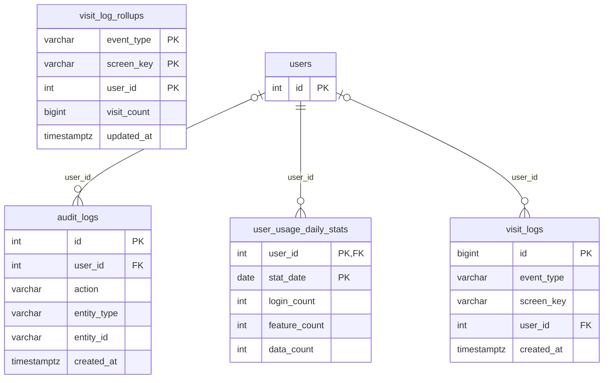

Bảng tham chiếu ngoài nhóm (chỉ vẽ khoá chính): `users`.

### `audit_logs`

Nhật ký ghi nhận các thao tác quan trọng trên hệ thống.

| Cột | Kiểu | Null | Mặc định | Khoá | Ghi chú |
|---|---|---|---|---|---|
| `id` | int (tự tăng) | không |  | PK |  |
| `user_id` | int | có |  | FK → users(id) |  |
| `action` | varchar(100) | không |  |  |  |
| `entity_type` | varchar(50) | không |  |  |  |
| `entity_id` | varchar(100) | không |  |  |  |
| `created_at` | timestamptz | có | CURRENT_TIMESTAMP |  |  |

### `user_usage_daily_stats`

Thống kê tần suất tương tác và sử dụng tính năng theo ngày của từng user.

| Cột | Kiểu | Null | Mặc định | Khoá | Ghi chú |
|---|---|---|---|---|---|
| `user_id` | int | không |  | PK, FK → users(id) |  |
| `stat_date` | date | không |  | PK |  |
| `login_count` | int | không | 0 |  |  |
| `feature_count` | int | không | 0 |  |  |
| `data_count` | int | không | 0 |  |  |

- index `idx_user_usage_daily_stats_date`: btree (stat_date)
- index `idx_user_usage_daily_stats_user`: btree (user_id)

### `visit_logs`

Ghi nhận nhật ký lượt đăng nhập ứng dụng (APP_LOGIN) và lượt xem 3 màn hình trọng điểm (SCREEN_VIEW cho TTM Dashboard 2, Quản trị Epic, Báo cáo Epic) phục vụ tính năng Visit Counter (mục 18).

| Cột | Kiểu | Null | Mặc định | Khoá | Ghi chú |
|---|---|---|---|---|---|
| `id` | bigint (tự tăng) | không |  | PK |  |
| `event_type` | varchar(20) | không |  |  |  |
| `screen_key` | varchar(50) | có |  |  |  |
| `user_id` | int | có |  | FK → users(id) |  |
| `created_at` | timestamptz | có | CURRENT_TIMESTAMP |  |  |

- index `idx_visit_logs_screen_created`: btree (screen_key, created_at)
- index `idx_visit_logs_type_created`: btree (event_type, created_at)
- index `idx_visit_logs_user_created`: btree (user_id, created_at)

### `visit_log_rollups`

Số lượt truy cập LŨY KẾ của các dòng `visit_logs` cũ hơn ngày T-15 (đã bị cuốn vào đây rồi xóa; theo `event_type`, `screen_key`, `user_id`) để các số "Tổng (lũy kế)" của Visit Counter không tụt khi job dọn dẹp xóa dòng cũ. `screen_key=''`: không có màn hình; `user_id=0`: user đã bị xóa.

| Cột | Kiểu | Null | Mặc định | Khoá | Ghi chú |
|---|---|---|---|---|---|
| `event_type` | varchar(20) | không |  | PK |  |
| `screen_key` | varchar(50) | không | ''::character varying | PK |  |
| `user_id` | int | không | 0 | PK |  |
| `visit_count` | bigint | không | 0 |  |  |
| `updated_at` | timestamptz | có | CURRENT_TIMESTAMP |  |  |

## 13. Danh sách khoá ngoại

| Bảng con | Cột | Tham chiếu | ON DELETE |
|---|---|---|---|
| `ad_popup_impressions` | popup_id | `ad_popups`(id) | CASCADE |
| `ad_popup_impressions` | user_id | `users`(id) | CASCADE |
| `audit_logs` | user_id | `users`(id) | SET NULL |
| `auth_sessions` | user_id | `users`(id) | CASCADE |
| `black_listed_epics` | updated_by_user_id | `users`(id) | SET NULL |
| `daily_cache_runs` | source_import_batch_id | `import_batches`(id) | SET NULL |
| `daily_cache_runs` | triggered_by_user_id | `users`(id) | SET NULL |
| `dashboard_view_settings` | updated_by_user_id | `users`(id) | SET NULL |
| `data_retention_configs` | history_thinning_updated_by_user_id | `users`(id) | SET NULL |
| `denied_import_epics` | added_by_user_id | `users`(id) | SET NULL |
| `epic_alert_timeline` | source_import_batch_id | `import_batches`(id) | SET NULL |
| `import_admission_settings` | updated_by_user_id | `users`(id) | SET NULL |
| `issues` | epic_id | `issues`(id) | SET NULL |
| `issues` | parent_id | `issues`(id) | SET NULL |
| `issues` | source_import_batch_id | `import_batches`(id) | CASCADE |
| `mcp_access_daily_stats` | user_id | `users`(id) | CASCADE |
| `mcp_access_tokens` | user_id | `users`(id) | CASCADE |
| `mcp_oauth_authorization_codes` | user_id | `users`(id) | CASCADE |
| `mcp_settings` | updated_by | `users`(id) | SET NULL |
| `password_reset_requests` | resolved_by | `users`(id) | SET NULL |
| `project_external_bindings` | project_id | `projects`(id) | CASCADE |
| `project_members` | project_id | `projects`(id) | CASCADE |
| `project_members` | user_id | `users`(id) | CASCADE |
| `project_type_capabilities` | project_type_id | `project_types`(id) | CASCADE |
| `projects` | domain_id | `domains`(id) | SET NULL |
| `projects` | project_type_id | `project_types`(id) | SET NULL |
| `role_feature_permissions` | feature_key | `permission_features`(feature_key) | CASCADE |
| `scoring_parameters` | updated_by_user_id | `users`(id) | SET NULL |
| `scoring_rule_group_history` | saved_by_user_id | `users`(id) | SET NULL |
| `scoring_rule_group_rules` | group_id | `scoring_rule_groups`(id) | CASCADE |
| `scoring_rule_groups` | updated_by_user_id | `users`(id) | SET NULL |
| `scoring_rule_settings` | updated_by_user_id | `users`(id) | SET NULL |
| `sso_auth_codes` | api_key_id | `api_keys`(id) | CASCADE |
| `sso_auth_codes` | user_id | `users`(id) | CASCADE |
| `ttm_index_global_cache` | source_import_batch_id | `import_batches`(id) | SET NULL |
| `ttm_project_configs` | project_id | `projects`(id) | CASCADE |
| `ttm_scope_config` | updated_by_user_id | `users`(id) | SET NULL |
| `user_domains` | domain_id | `domains`(id) | CASCADE |
| `user_domains` | user_id | `users`(id) | CASCADE |
| `user_project_components` | user_id, project_id | `user_projects`(user_id, project_id) | CASCADE |
| `user_projects` | project_id | `projects`(id) | CASCADE |
| `user_projects` | user_id | `users`(id) | CASCADE |
| `user_usage_daily_stats` | user_id | `users`(id) | CASCADE |
| `visit_logs` | user_id | `users`(id) | SET NULL |
